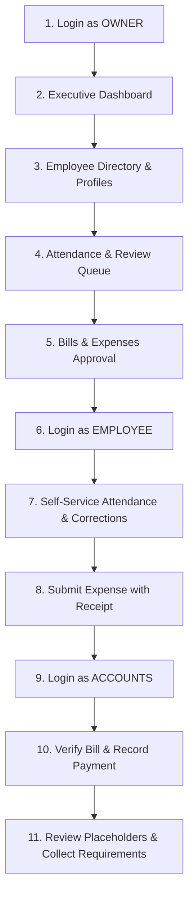

# EMS Current-State Context & Owner-Review Handoff Document

**Project:** LanternHR / Aluminium Factory Employee Operations Management System (EMS)  
**Corpus / Repository:** `TheVishKay/Alum_Factory_EMS` (`employee-operations-management-system`)  
**Active Git Branch:** `feature/payroll-module`  
**Audit Date:** September 17, 2026  
**Audit Mode:** Deep Read-Only Static Repository Audit (Zero Mutations, No Database Reset, No Docker/Supabase Startup)  

---

## 1. Executive Summary

This document provides a factual, evidence-based current-state analysis of the **LanternHR / Aluminium Factory Employee Operations Management System (EMS)** repository. 

The application is an internal, role-based operations console designed for an aluminium manufacturing facility employing approximately 40–50 staff members (directors, plant supervisors, accountants, engineers, and administrative staff). It is built with **React 19**, **Vite 8**, **Tailwind CSS v4**, and **Supabase (PostgreSQL 15+)** leveraging Supabase Auth, Row-Level Security (RLS), and `SECURITY DEFINER` Remote Procedure Calls (RPCs).

### Summary of System Status:
1. **Strongest, Working Modules:**
   - **Employee Management:** Core employee directory, department/designation management, role updates via RPC, and user provisioning/status lifecycle via Edge Functions are implemented.
   - **Attendance Tracking:** Daily employee check-in and check-out (server-timestamped via RPCs), attendance status consistency enforcement (`PRESENT`, `HALF_DAY`, `ABSENT`, `LEAVE`, `INCOMPLETE`), and an attendance correction request/approval workflow for the factory owner are implemented.
   - **Bills & Expenses:** A multi-stage review and reimbursement pipeline (`DRAFT` → `SUBMITTED` → `PENDING_OWNER_APPROVAL` → `PAYMENT_PENDING` → `PAID`, with return/reject cycles), document attachment upload/download via private Supabase Storage, and formal payment recording in `public.payments`.
   - **Task Management (Kanban):** A recently added Kanban board (`public.tasks`, Migration `20260916125019_tasks.sql`) integrated with drag-and-drop position reordering via RPC.

2. **Partially Implemented & Disconnected Workflows:**
   - **Leave Management:** Complete local code and migration (`20260913000001_leave_management.sql`) with automated attendance sync upon owner approval. However, deployment to the remote Supabase project is **unverified**, and the schema contains **no concept of leave types (casual, sick, earned), paid vs. unpaid leave, or leave quotas/balances**.
   - **Emergency Contact & Personal Info Visibility:** The database table `public.employee_personal_info` secures personal email, personal phone, address, and emergency contacts, and RLS permits `OWNER` access. However, **no UI exists in the application for the Factory Owner to view or edit an employee's emergency contact or personal information**.

3. **Mocked & Placeholder Modules:**
   - **Reports (`/reports`):** Entirely cosmetic. Displays hardcoded category counts (`3`, `5`, `4`, `6`, `2`) and simply links to other pages. No report generation, filtering, or PDF/Excel export exists.
   - **Settings (`/settings`):** Pure prototype. Controls use local React state pre-filled with dummy data ("Admin", "Meridian Workforce Ltd."). No database persistence exists; all toggles revert on reload.
   - **Notifications (`src/pages/Notifications.jsx`):** A 18-line placeholder banner ("Real-time notifications are not available in V1"). It is not even registered in the application router.

4. **Payroll Status:**
   - **Specification Only (`PAYROLL_MODULE_SPECIFICATION.md`).**
   - **0 lines of application code, 0 database tables, 0 migrations, 0 RPCs, and 0 routes exist in the repository for Payroll.**
   - Existing employee records have **no salary, CTC, or bank details fields**.
   - Existing expense payments in `public.payments` strictly reference `public.expenses(id)` and **cannot be reused for salary disbursements**.

5. **Production Readiness Verdict:**
   - **Not Production-Ready.** While core workflows (Attendance, Employee Directory, Expenses) have strong security architectures, the system cannot be deployed into live factory operations until remote migration deployment is confirmed, emergency contact visibility is built, critical workflow edge cases (such as missing attendance records blocking correction requests) are resolved, and the factory owner validates factory operating policies.

---

## 2. Repository and Branch Information

* **Repository Name:** `employee-operations-management-system` (GitHub: `TheVishKay/Alum_Factory_EMS`)
* **Current Working Git Branch:** `feature/payroll-module`
* **Local Branch List:** `backup-before-sync`, `backup-remote-main`, `feature/payroll-module` (active), `main`
* **Working Tree State:** Clean, with exactly **one untracked specification file**:
  - `PAYROLL_MODULE_SPECIFICATION.md` (untracked, 51.6 KB, created September 17, 2026)
* **Recent Relevant Commits:**
  - `b14d6cf` (*2026-09-17 10:16:20 +0530*): `added small changes` — un-hid "New Expense" button in `src/pages/BillsExpenses.jsx`.
  - `64a456e` (*2026-09-17 10:00:32 +0530*): Merge pull request #21 — `security: revoke execute on public for employee management rpcs` (`20260906000002_employee_management_rpc.sql`).
  - `1c230c8` (*2026-09-17 09:46:09 +0530*): Merge pull request #22 — `perf: memoize unique statuses array on render` in `BillsExpenses.jsx`.
* **Repository Architecture:** Single-package frontend with embedded Supabase backend folder:
  - `src/` — React frontend application.
  - `supabase/migrations/` — 22 sequential PostgreSQL migration scripts.
  - `supabase/functions/` — Deno TypeScript Edge Functions (`create-employee`, `update-employee-status`).
  - `docs/` — Phase completion logs (`Phase_4_Bills_Expenses_Completion_Log.md`).
* **Package Scripts (`package.json`):**
  - `npm run dev`: `vite` (starts local development server)
  - `npm run build`: `vite build` (compiles production bundle)
  - `npm run preview`: `vite preview` (previews production build)
  - `npm run lint`: `eslint .` (runs ESLint checks; passes with 0 errors, 5 fast-refresh warnings)
  - `npm run format`: `prettier --write .` (formats code)
* **Supabase Project Association:**
  - Local configuration references remote project ID `zutnttsrapajckbwfgwr` in `supabase/.temp/linked-project.json`.
* **Environment Configuration:**
  - Client-side variables declared in `.env.example`:
    - `VITE_SUPABASE_URL`
    - `VITE_SUPABASE_PUBLISHABLE_KEY` (also referenced in Edge Functions as `SUPABASE_ANON_KEY`)
  - Server-side Edge Function secrets:
    - `SUPABASE_SERVICE_ROLE_KEY`
  - *No secret keys or credentials were exposed during this audit.*

---

## 3. Technology Stack

| Layer | Technology / Package | Version | Purpose in EMS |
| :--- | :--- | :--- | :--- |
| **Core Framework** | React | `^19.2.0` | Declarative UI rendering |
| **Runtime & DOM** | React DOM | `^19.2.0` | Browser DOM binding |
| **Build Engine** | Vite | `8.1.5` | Bundling, HMR, asset compilation |
| **Routing** | React Router DOM | `^7.3.0` | Client-side routing, protected routes |
| **Styling** | Tailwind CSS / `@tailwindcss/vite` | `^4.2.1` | Utility styling with custom oklch theme tokens |
| **UI Primitives** | Radix UI primitives | Latest | Accessible Dialogs, Dropdowns, Selects, Tabs |
| **Icons** | Lucide React | `^0.575.0` | Ops Console UI iconography |
| **Data Visuals** | Recharts | `^2.15.4` | Expense category distribution chart |
| **Interactivity** | `@hello-pangea/dnd` | `^18.0.1` | Drag-and-drop Kanban task boards |
| **Backend / DB** | Supabase JS Client | `^2.112.4` | Data querying, Auth sessions, RPC calls |
| **Database** | PostgreSQL | 15+ | Relational schema, RLS, triggers, functions |
| **Edge Compute** | Deno (Supabase Functions) | Latest | Privileged auth creation and user banning |

---

## 4. Application Architecture

### 4.1 Entry Point & Routing
- **Entry Point:** `index.html` loads `src/main.jsx`, which mounts `src/App.jsx` wrapped inside `AuthProvider` and `BrowserRouter`.
- **Router Configuration (`src/App.jsx`):**
  - Public route: `/login` (`Login.jsx`).
  - All operational routes are nested inside `ProtectedRoute` and wrapped with `AppLayout`:
    - `/` → `Dashboard.jsx` (All authenticated roles)
    - `/employees` → `Employees.jsx` (Restricted: `OWNER`, `ACCOUNTS`)
    - `/employees/:employeeId` → `EmployeeProfile.jsx` (Restricted: `OWNER`, `ACCOUNTS`, `EMPLOYEE`)
    - `/attendance` → `Attendance.jsx` (All authenticated roles)
    - `/leave` → `LeaveManagement.jsx` (Restricted: `OWNER`, `EMPLOYEE`, `ACCOUNTS`)
    - `/tasks` → `Tasks.jsx` (Restricted: `OWNER`, `EMPLOYEE`, `ACCOUNTS`)
    - `/bills` → `BillsExpenses.jsx` (All authenticated roles)
    - `/reports` → `Reports.jsx` (Restricted: `OWNER`, `ACCOUNTS`)
    - `/reports/leave` → `LeaveReports.jsx` (Restricted: `OWNER`)
    - `/settings` → `Settings.jsx` (Restricted: `OWNER`)
    - `/profile` → `Profile.jsx` (All authenticated roles)
    - `*` → `NotFound.jsx`

### 4.2 Layout & Navigation Hierarchy
- **`AppLayout` (`src/components/layout/AppLayout.jsx`):** Houses the responsive `Sidebar` and sticky `Header`.
- **`Sidebar` (`src/components/layout/Sidebar.jsx`):** Dynamically filters navigation links based on `profile?.role`.
- **`Header` (`src/components/layout/Header.jsx`):** Shows page title, active user avatar, and a search input.
  - *Friction Point:* Header search input has an Enter key listener that only navigates to `/employees?q=...`. It does not search bills or attendance despite placeholder text.

### 4.3 Service Layer Pattern & Inconsistencies
- `src/services/employeeService.js`: Wraps Edge Function calls, role RPCs, and core employee queries.
- `src/services/leaveService.js`: Wraps leave queries and RPCs (`submit_leave_request`, `review_leave_request`, `cancel_pending_leave`).
- `src/services/taskService.js`: Wraps task board CRUD and `update_task_positions` RPC.
- **Architectural Inconsistency:** Unlike Employee, Leave, and Task modules, **Attendance (`Attendance.jsx`) and Bills & Expenses (`BillsExpenses.jsx`) do not use service files**. They invoke Supabase queries and RPCs directly within component files (e.g., `supabase.rpc("check_in")`, `supabase.rpc("create_expense")`).

---

## 5. Authentication and Roles

### 5.1 Authentication Flow
1. User enters email and password on `/login`.
2. `supabase.auth.signInWithPassword()` authenticates the credential against Supabase Auth (`auth.users`).
3. `AuthContext.jsx` catches the session change in `onAuthStateChange`, extracts `session.user.id`, and queries `public.profiles` for `role`, `full_name`, and `avatar_url`.
4. If `profiles` row is missing or fails to load, `ProtectedRoute.jsx` renders a blocking "Profile Error" card with a sign-out button, preventing corrupted sessions from browsing.

### 5.2 Role Enforcement Mechanism
The EMS enforces a three-tier role model:
- `OWNER`: Factory owner / managing director. Unrestricted system governance, financial approvals, employee lifecycle, and attendance correction review.
- `ACCOUNTS`: Factory accounting department. Expense initial review, payment disbursements, employee directory inspection, and attendance monitoring.
- `EMPLOYEE`: Plant engineers, supervisors, and administrative staff. Self-service check-in/out, correction requests, leave requests, bill submissions, and viewing personal profile.

**Two-Layer Defense:**
1. **Frontend Layer:** `RoleRoute` (`src/components/auth/RoleRoute.jsx`) checks `allowedRoles.includes(profile.role)`. If unauthorized, redirects to `/`.
2. **Database Layer:** The database NEVER trusts client-side role claims. Tables use RLS policies with `public.get_my_role()`, which reads the authoritative `role` directly from `public.profiles` using `auth.uid()`. All mutation RPCs explicitly verify `public.get_my_role() = 'OWNER'` or `'ACCOUNTS'`.

---

## 6. Module-by-Module Audit

### 6.1 Employee Management

#### Current status
Partially working. Core workflows function, but emergency contacts are inaccessible to the Factory Owner in the UI.

#### User-facing functionality
- Browse workforce directory with live search (name, code, email), department filter, and status filter (`ACTIVE`, `INACTIVE`, `EXITED`).
- Summary stat cards: Total Employees, Active, Inactive/Exited, and Department count.
- Department Management dialog: create and edit departments.
- Designation Management dialog: create and edit designations.
- Add Employee dialog: provisions employee login and profile.
- Double-clicking any employee row opens `/employees/:employeeId` showing Employment details, Attendance history, and Leave history.
- Row action menu (`...`) on each employee to edit core details, change employment status, or change role.

#### OWNER capabilities
- Create new employees with automatic Auth account generation.
- Edit core details (first name, last name, code, department, designation, joining date).
- Update employment status (`ACTIVE`, `INACTIVE`, `EXITED`) with automatic ban enforcement.
- Change application role (`OWNER`, `ACCOUNTS`, `EMPLOYEE`).
- Create and modify departments and designations.

#### ACCOUNTS capabilities
- Read-only directory access.
- Row action menu button is explicitly disabled (`disabled` prop in `Employees.jsx:349`). Cannot edit or create employees.

#### EMPLOYEE capabilities
- Forbidden from accessing `/employees` (redirected by `RoleRoute`).
- Permitted to view `/employees/:employeeId` **only if** `data.user_id === profile.id`. Attempting to view another employee displays "Access Denied".
- Can view and edit their own personal information (phone, personal email, address, emergency contact) on `/profile`.

#### Frontend files
- `src/pages/Employees.jsx` (Directory table, filters, stat cards)
- `src/pages/EmployeeProfile.jsx` (Individual employee drilldown)
- `src/pages/Profile.jsx` (Self-service profile and emergency contact editor)
- `src/components/employees/EmployeeFormDialog.jsx` (Add employee modal)
- `src/components/employees/EmployeeActionsMenu.jsx` (Edit, Status change, Role change dropdown)
- `src/components/employees/DepartmentManagementDialog.jsx`
- `src/components/employees/DesignationManagementDialog.jsx`
- `src/services/employeeService.js`

#### Services and backend calls
- Edge Function `create-employee` (creates auth user via admin client, inserts `profiles`, `employees`, `employee_personal_info`, writes audit log).
- Edge Function `update-employee-status` (updates status, applies 100-year auth ban if `EXITED`, lifts ban if reinstated).
- RPC `public.update_employee_role(p_user_id, p_new_role)` (SECURITY DEFINER, OWNER only).
- Direct queries on `departments`, `designations`, `employees`.

#### Database dependencies
- Tables: `public.employees`, `public.employee_personal_info`, `public.departments`, `public.designations`, `public.profiles`, `public.audit_logs`.
- Enums: `public.employment_status`, `public.employment_type`, `public.app_role`.

#### Security and permissions
- RLS enabled on all tables.
- Employee creation uses a secure Edge Function with the service-role key kept server-side; client never touches admin credentials.
- `update_employee_role` explicitly checks `public.get_my_role() = 'OWNER'`.

#### Validation and error handling
- Email and minimum 6-character password required in Edge Function.
- Core employee fields validated before submission.
- Confirmation dialogs (`ConfirmDialog.jsx`) required before applying status or role changes.

#### Current limitations
1. **Critical UI Gap:** The `OWNER` cannot view an employee's emergency contact or personal information anywhere in `Employees.jsx`, `EmployeeActionsMenu.jsx`, or `EmployeeProfile.jsx`. If a factory accident occurs, the owner has no way to retrieve emergency contacts from the interface.
2. **Missing Exit Date Field:** When changing status to `EXITED`, no exit date or termination reason is captured.
3. **No Salary Fields:** There are no compensation figures, wage rates, or bank details stored in `employees` or `employee_personal_info`.

#### Evidence
- `src/pages/Employees.jsx:234-250` (Dialogs restricted to `OWNER`)
- `src/pages/Employees.jsx:336-354` (Actions menu enabled for `OWNER`, disabled for other roles)
- `src/pages/EmployeeProfile.jsx:360-363` (Ownership check blocking peer employee snooping)
- `supabase/functions/create-employee/index.ts:51-59` (OWNER verification in backend)
- `supabase/functions/update-employee-status/index.ts:92-97` (Auth ban on `EXITED`)

---

### 6.2 Attendance Management

#### Current status
Working, but limited by single-date filtering and lack of missing attendance correction initiates.

#### User-facing functionality
- Interactive daily Check-In and Check-Out banner for the logged-in employee.
- Stat cards: Total records for selected date, Present, Incomplete, Absent/Leave.
- Daily attendance table with employee name, code, department, date, check-in time, check-out time, calculated work hours, and status badge.
- Search input, department dropdown filter, status filter, and HTML5 date picker.
- "Correct" action button on employee's own row to open `AttendanceCorrectionModal`.
- Visual status badges for correction requests (`Pending`, `Approved`, `Rejected` with owner remarks).
- Owner-only "Pending Correction Requests" review queue card with side-by-side comparison of original vs. requested times and Approve/Reject buttons.

#### OWNER capabilities
- View all company attendance records for any selected date.
- Inspect and review all pending attendance correction requests submitted across the factory.
- Approve or reject corrections with optional or mandatory review remarks.

#### ACCOUNTS capabilities
- View all company attendance records for any selected date.
- Review queue is intentionally hidden; ACCOUNTS cannot approve or reject attendance corrections.

#### EMPLOYEE capabilities
- Check in (sets status to `INCOMPLETE` with current server timestamp).
- Check out (updates status to `PRESENT` with current server timestamp).
- Request attendance corrections on their own existing daily records.
- View real-time review status of their submitted correction requests.

#### Frontend files
- `src/pages/Attendance.jsx`
- `src/components/attendance/AttendanceCorrectionModal.jsx`

#### Services and backend calls
- RPC `public.check_in()`: Server-side timestamp check-in.
- RPC `public.check_out()`: Server-side timestamp check-out.
- RPC `public.request_attendance_correction(p_attendance_record_id, p_requested_status, p_requested_check_in, p_requested_check_out, p_reason)`.
- RPC `public.review_attendance_correction(p_request_id, p_approve, p_remarks)` (OWNER only).
- Direct query on `public.attendance_records` and `public.attendance_correction_requests`.

#### Database dependencies
- Tables: `public.attendance_records`, `public.attendance_correction_requests`, `public.employees`, `public.departments`, `public.audit_logs`.
- Enums: `public.attendance_status`, `public.attendance_source`, `public.correction_status`.

#### Security and permissions
- Server-authoritative timestamps in `check_in()` and `check_out()` eliminate device clock manipulation.
- Strict CHECK constraint `attendance_status_consistency` prevents database corruption (e.g. check-out earlier than check-in, or `PRESENT` without check-in/out).
- `request_attendance_correction` checks `employee_id` belongs to `auth.uid()`.
- `review_attendance_correction` verifies `public.get_my_role() = 'OWNER'`.

#### Validation and error handling
- Future-date attendance creation is prohibited.
- Check-out before check-in is rejected by constraint.
- Duplicate attendance for the same employee on the same date is blocked by `unique_employee_attendance_day`.
- Duplicate pending corrections on the same record are blocked by partial unique index `unique_pending_correction_request`.

#### Current limitations
1. **Single-Date View Only:** The attendance table **only queries records where `attendance_date IN (filterDate, today)`** (`Attendance.jsx:297-320`). There is no monthly view, weekly view, or date-range picker. Management cannot see an employee's monthly attendance summary on this screen.
2. **Cannot Correct Unrecorded Absent Days:** If an employee forgot to check in, no row was created in `attendance_records`. Because `request_attendance_correction` requires an existing `attendance_record_id`, **an employee cannot submit a correction for a day with no record**.
3. **No Correction Outcome Notifications:** Employees receive no push, in-app, or email notification when a correction is approved or rejected. They must manually change the date filter on `/attendance` to that exact day to see the outcome.

#### Evidence
- `src/pages/Attendance.jsx:296-320` (`datesToFetch` logic restricted to activeDate and today)
- `src/pages/Attendance.jsx:545-585` (`check_in` and `check_out` RPC invocations)
- `src/pages/Attendance.jsx:623-673` (`request_attendance_correction` RPC invocation)
- `src/pages/Attendance.jsx:683-730` (`review_attendance_correction` RPC invocation)
- `supabase/migrations/20260831000200_attendance.sql:136-176` (Status consistency constraint)

---

### 6.3 Leave Management

#### Current status
Implemented in code, but remote database deployment is unverified. Completely lacks leave balance and paid/unpaid classification.

#### User-facing functionality
- "Request Leave" dialog: select start date, end date, and enter reason.
- My Leave Requests table: lists user's leave requests with date range, duration in days, reason, status badge, and owner remarks.
- Ability to cancel a `PENDING` leave request.
- Owner review section: list of pending leave requests from employees with Approve and Reject actions.
- `/reports/leave` route (`LeaveReports.jsx`) providing an overview of all employee leave requests.

#### OWNER capabilities
- View all employee leave requests across the factory.
- Approve leave requests (triggers automated insert/update into `attendance_records` for the date range).
- Reject leave requests with remarks.

#### ACCOUNTS capabilities
- Allowed route access by `App.jsx`, but cannot review leaves.

#### EMPLOYEE capabilities
- Submit leave requests for upcoming dates.
- Cancel own pending leave requests.
- View history of own approved/rejected leaves.

#### Frontend files
- `src/pages/LeaveManagement.jsx`
- `src/pages/LeaveReports.jsx`
- `src/services/leaveService.js`
- `supabase/migrations/20260913000001_leave_management.sql`
- `supabase/migrations/20260914000001_fix_leave_grants.sql`

#### Services and backend calls
- RPC `public.submit_leave_request(p_start_date, p_end_date, p_reason)`.
- RPC `public.cancel_pending_leave(p_leave_id)`.
- RPC `public.review_leave_request(p_leave_id, p_approve, p_remarks)`.
- Queries `public.leave_requests`.

#### Database dependencies
- Tables: `public.leave_requests`, `public.attendance_records`, `public.employees`, `public.profiles`, `public.audit_logs`.
- Enum: `public.leave_status` (`PENDING`, `APPROVED`, `REJECTED`, `CANCELLED`).

#### Security and permissions
- RLS enforces employee read isolation on `leave_requests`.
- `review_leave_request` RPC enforces `public.get_my_role() = 'OWNER'`.
- Atomicity: `review_leave_request` pre-validates that no dates in the range have `PRESENT`, `HALF_DAY`, or `INCOMPLETE` punches before mutating attendance.

#### Validation and error handling
- Check constraint `leave_start_before_end` ensures `start_date <= end_date`.
- Conflicting attendance punches cause the approval RPC to abort with `Attendance conflict on YYYY-MM-DD`.

#### Current limitations
1. **Unverified Remote Deployment:** Migration `20260913000001_leave_management.sql` was authored recently. Without connecting to the live Supabase project, its presence in production cannot be verified from repository files alone.
2. **Zero Quota / Balance Management:** There are **no leave quotas, leave balances, or accrual rules**. An employee can submit unlimited leave days.
3. **No Paid vs. Unpaid Classification:** Leaves are simply `LEAVE`. The system does not differentiate between Paid Leave (Casual/Sick) and Unpaid Leave (Loss of Pay).
4. **Full-Day Only:** Half-day leaves are not supported; fields are `DATE`.

#### Evidence
- `supabase/migrations/20260913000001_leave_management.sql:277-315` (Attendance conflict pre-flight check and insertion of `status = 'LEAVE'`)
- `src/services/leaveService.js:74-103` (RPC wrapper functions)
- `src/pages/LeaveReports.jsx:25` (`fetchAllLeaveRequests` call)

---

### 6.4 Bills & Expenses

#### Current status
Working and feature-rich. Strong workflow separation, document handling, and payment tracking.

#### User-facing functionality
- Expense listing table with filters for status, category, and text search.
- Category breakdown bar chart (Recharts) aggregating expense amounts.
- Metric cards: "Needs My Action", Total Expenses, Approved, Pending, Rejected.
- Expense creation/edit dialog: Category, Vendor Name, Invoice Number, Description, Amount, Date, Currency (`INR`).
- Document attachment manager: Upload receipts/invoices, view document list, download via secure signed URLs, delete attachments.
- Action workflows:
  - Submit Draft.
  - Delete Draft.
  - Accounts Review: Approve, Reject (requires remarks), Return for correction (requires remarks).
  - Owner Review: Approve, Reject (requires remarks).
  - Record Payment (Accounts only): Payment Amount, Payment Date, Payment Method (`BANK_TRANSFER`, `UPI`, `CHEQUE`, `CASH`, `OTHER`), Transaction Reference, Notes.
  - Expense details inspection dialog with full audit timeline.

#### OWNER capabilities
- Final financial approval on expenses in `PENDING_OWNER_APPROVAL` status.
- Reject expenses with mandatory remarks.
- View all factory expenses, attached receipts, and payment references.

#### ACCOUNTS capabilities
- Initial verification of submitted expenses (`SUBMITTED` → `PENDING_OWNER_APPROVAL`, `REJECTED_BY_ACCOUNTS`, or `RETURNED_FOR_CORRECTION`).
- Record disbursements on approved expenses (`PAYMENT_PENDING` → `PAID`), creating records in `public.payments`.

#### EMPLOYEE capabilities
- Create draft expenses, attach document receipts, and submit for reimbursement.
- Edit and re-submit expenses returned for correction.
- Delete drafts.
- View payment status and transaction references for own claims.

#### Frontend files
- `src/pages/BillsExpenses.jsx`
- `src/components/expenses/ExpenseFormDialog.jsx`
- `src/components/expenses/ExpenseDetailsDialog.jsx`
- `src/components/expenses/ExpenseReviewDialog.jsx`
- `src/components/expenses/PaymentRecordDialog.jsx`
- `src/components/expenses/ExpenseDocuments.jsx`

#### Services and backend calls
- RPC `create_expense`, `update_expense`, `delete_draft_expense`, `submit_expense`.
- RPC `review_expense_accounts` (ACCOUNTS only).
- RPC `review_expense_owner` (OWNER only).
- RPC `record_payment` (ACCOUNTS only).
- Supabase Storage API: Upload, remove, and `createSignedUrl` on bucket `expense-documents`.

#### Database dependencies
- Tables: `public.expenses`, `public.expense_categories`, `public.expense_documents`, `public.payments`, `public.employees`, `public.profiles`, `public.audit_logs`.
- Enums: `public.expense_status`, `public.payment_method`.
- Storage: Bucket `expense-documents` (private).

#### Security and permissions
- RLS default-deny on direct table modifications; all status transitions enforce valid predecessor states inside transactional RPCs.
- Storage bucket `expense-documents` is private. Storage RLS validates that uploaded document paths match `expense_id` and the user owns the draft.
- Storage upload policy enforces strict MIME type whitelist: `image/jpeg`, `image/png`, `application/pdf`.

#### Validation and error handling
- Future-dated expenses rejected.
- Negative or zero amounts rejected.
- File deletion removes DB metadata first; if DB deletion succeeds, storage object is purged.
- Unique constraint on `payments.expense_id` prevents duplicate disbursements.

#### Current limitations
1. **Critical Submission Trap for Owner/Accounts:** Commit `b14d6cf` made the "New Expense" button visible to all roles. However, the database RPC `create_expense` explicitly checks:
   ```sql
   SELECT id INTO v_employee_id FROM public.employees WHERE user_id = auth.uid() AND employment_status = 'ACTIVE';
   IF v_employee_id IS NULL THEN RAISE EXCEPTION 'Active employee record not found'; END IF;
   ```
   If an `OWNER` or `ACCOUNTS` user attempts to submit an expense but does not have a linked record in `public.employees`, the database throws a runtime exception.
2. **Decoupled from Payroll:** `public.payments` strictly requires an `expense_id`. It cannot handle partial payments, salary advances, or monthly payroll.

#### Evidence
- `src/pages/BillsExpenses.jsx:528-537` ("New Expense" button rendered unconditionally)
- `supabase/migrations/20260906000006_audit_bill_created.sql:47-55` (`create_expense` active employee requirement)
- `supabase/migrations/20260831000300_expenses_and_payments.sql:338-340` (`payments.expense_id` UNIQUE FK constraint)
- `supabase/migrations/20260906000005_expense_document_mime_security.sql:25` (MIME restriction)

---

### 6.5 Reports

#### Current status
Placeholder / Navigational Mock.

#### User-facing functionality
- Category cards: "Attendance Reports", "Employee Reports", "Leave Reports", "Expense Reports", "Workforce Analytics".
- Static badges displaying hardcoded numbers: `3 reports`, `5 reports`, `4 reports`, `6 reports`, `2 reports`.
- Clicking a card navigates to the respective module (`/attendance`, `/employees`, `/reports/leave`, `/bills`, `/`).
- "Full Report Builder — Coming Soon" banner with disabled "Request Early Access" button.

#### OWNER & ACCOUNTS capabilities
- Allowed to open `/reports`.
- Can view `/reports/leave` (OWNER only) to see a list of leave requests.

#### EMPLOYEE capabilities
- Blocked by `RoleRoute` from `/reports` and `/reports/leave`.

#### Frontend files
- `src/pages/Reports.jsx`
- `src/pages/LeaveReports.jsx`

#### Services and backend calls
- No report generation service exists. `Reports.jsx` executes zero database queries.

#### Current limitations
- Completely non-functional for reporting. No aggregation queries, attendance summary metrics, cost analytics, or data exports (CSV/PDF) exist.

#### Evidence
- `src/pages/Reports.jsx:7-49` (Hardcoded report categories array and counts)
- `src/pages/Reports.jsx:109-121` (Coming soon placeholder)

---

### 6.6 Notifications

#### Current status
Placeholder.

#### User-facing functionality
- Displays an icon and message: *"Real-time notifications are not available in V1. This feature is coming soon."*

#### Frontend files
- `src/pages/Notifications.jsx` (18 lines)

#### Backend dependencies
- None. No notification tables, Supabase Realtime subscriptions, or push/email services exist.
- Notice: The component is **not registered in `App.jsx` routes** and there is no bell icon or notification badge in `Header.jsx`.

#### Current limitations
- Feature does not exist.

#### Evidence
- `src/pages/Notifications.jsx:11-13` ("Real-time notifications are not available in V1...")
- `src/App.jsx:34-152` (Absence of `/notifications` route)
- `src/components/layout/Header.jsx:56-94` (Absence of notification bell trigger)

---

### 6.7 Settings

#### Current status
Mockup.

#### User-facing functionality
- Profile fields: Name, Email, Phone, Role.
- Notification toggles: Email notifications, Leave alerts, Bill alerts, Task alerts, Attendance alerts.
- Appearance: Theme selector (`system`, `light`, `dark`), Date format selector, Currency selector.
- "Save Changes" button displays a temporary green checkmark for 2.5 seconds.

#### Current limitations
- **Zero Persistence:** All inputs are wired to local React `useState` initialized with dummy strings (`"Admin"`, `"admin@meridianworks.in"`, `"+91 98765 00001"`).
- `handleSave` does not execute an API call or write to `localStorage`. Refreshing the browser resets all toggles.

#### Evidence
- `src/pages/Settings.jsx:56-79` (Local state declarations and dummy save timeout)
- `src/pages/Settings.jsx:95-98` (Hardcoded "Meridian Workforce Ltd.")

---

### 6.8 Payroll

#### Current status
Specification Only (`PAYROLL_MODULE_SPECIFICATION.md`). Not Implemented.

#### Repository Findings
- **Application Code:** **0 files.** No `Payroll.jsx`, no payroll components, no `payrollService.js`.
- **Routes & Navigation:** **0 entries.** `src/App.jsx` and `src/components/layout/Sidebar.jsx` contain no payroll routes or links.
- **Database Schema:** **0 tables.** Migrations stop at `20260916125019_tasks.sql`. There are no payroll tables, enums, or RPCs in the database.
- **Employee Fields:** Existing `public.employees` table has **no basic salary, gross CTC, hourly rates, or bank account fields**.

#### Summary of the Existing Specification (`PAYROLL_MODULE_SPECIFICATION.md`)
The specification proposes:
- 8 new database tables: `payroll_periods`, `employee_salary_structures`, `payroll_entries`, `payroll_entry_items`, `payroll_adjustments`, `employee_advances`, `salary_disbursements`, `payslips`.
- Monthly cycle states: `DRAFT` → `CALCULATING` → `CALCULATED` → `PENDING_APPROVAL` → `APPROVED` → `LOCKED` → `PAID` → `CLOSED`.
- Formula: Daily Rate = Gross CTC ÷ Calendar Days. LOP Deduction = Daily Rate × (Absent Days + Incomplete Days + Unpaid Leave + (0.5 × Half Days)). Net Pay = Gross Earnings − Total Deductions (clamped to ₹0).
- Dedicated disbursement recording via `salary_disbursements` to prevent collisions with `public.payments`.

#### Specification Conflicts & Unconfirmed Business Rules
1. **Unpaid Leave Formula Conflict:** The spec formula references `Unpaid Leave Days`, but existing `public.leave_requests` and `public.attendance_records` do **not** record whether an approved leave is paid or unpaid.
2. **Missing Attendance Conflict:** If an employee forgets to punch in, no record exists in `attendance_records`. The spec calculation assumes unrecorded days are counted as absences, which requires calendar reconciliation logic.
3. **Day Divisor Unconfirmed:** Whether daily wages are computed using actual calendar days (28–31), standard 30 days, or factory working days (excluding Sunday and factory holidays) has not been confirmed by the factory owner.
4. **Statutory Deductions:** The spec assumes PF, ESIC, and Professional Tax are optional manual components in MVP because employee tax IDs (PAN, UAN, ESIC) do not exist.

#### Evidence
- `PAYROLL_MODULE_SPECIFICATION.md:1-797` (Untracked specification file)
- `supabase/migrations/` (Absence of any migration mentioning payroll)
- `src/App.jsx:34-152` (Absence of payroll route)

---

### 6.9 Task Management (Kanban)

#### Current status
Working prototype connected to Supabase.

#### User-facing functionality
- Drag-and-drop Kanban board with statuses: `Created`, `Assigned`, `In Progress`, `For Review`, `Returned`, `Completed`, `Cancelled`.
- Search by task title/description; filter by status and priority (`LOW`, `MEDIUM`, `HIGH`, `URGENT`).
- Create Task modal: Title, description, assignee dropdown (populated from `public.employees`), priority, status, due date.
- Floating-point position reordering during drag-and-drop.

#### OWNER capabilities
- Create, edit, delete, and reorder all tasks.

#### EMPLOYEE & ACCOUNTS capabilities
- Read-only visibility into tasks assigned to their employee record (`assigned_to_id`).
- Mutation policies (`INSERT`, `UPDATE`, `DELETE`) deny non-owners.

#### Frontend files
- `src/pages/Tasks.jsx`
- `src/services/taskService.js`
- `supabase/migrations/20260916125019_tasks.sql`

#### Evidence
- `supabase/migrations/20260916125019_tasks.sql:57-99` (RLS policies restricting mutations to `OWNER`)
- `src/services/taskService.js:130-139` (`update_task_positions` RPC call)

---

## 7. Database Inventory

The repository defines exactly **14 relational tables** and **9 custom ENUM types** across 22 migration scripts.

### 7.1 Custom Types & Enums
1. `public.app_role`: `'OWNER'`, `'ACCOUNTS'`, `'EMPLOYEE'`
2. `public.employment_status`: `'ACTIVE'`, `'INACTIVE'`, `'EXITED'`
3. `public.employment_type`: `'FULL_TIME'`, `'PART_TIME'`, `'CONTRACT'`, `'INTERN'`
4. `public.attendance_status`: `'PRESENT'`, `'ABSENT'`, `'HALF_DAY'`, `'LEAVE'`, `'INCOMPLETE'`
5. `public.attendance_source`: `'SELF'`, `'MANUAL'`, `'CORRECTED'`
6. `public.correction_status`: `'PENDING'`, `'APPROVED'`, `'REJECTED'`
7. `public.expense_status`: `'DRAFT'`, `'SUBMITTED'`, `'RETURNED_FOR_CORRECTION'`, `'PENDING_OWNER_APPROVAL'`, `'PAYMENT_PENDING'`, `'PAID'`, `'REJECTED_BY_ACCOUNTS'`, `'REJECTED_BY_OWNER'`
8. `public.payment_method`: `'BANK_TRANSFER'`, `'UPI'`, `'CHEQUE'`, `'CASH'`, `'OTHER'`
9. `public.leave_status`: `'PENDING'`, `'APPROVED'`, `'REJECTED'`, `'CANCELLED'`

---

### 7.2 Tables Detailed Matrix

| Table Name | Migration Defined | Primary Key | Key Foreign Keys & Constraints | RLS Status | Mutation Access Route |
| :--- | :--- | :--- | :--- | :--- | :--- |
| `public.profiles` | `001` | `id (UUID)` | `id -> auth.users(id) ON DELETE CASCADE` | Enabled | Auth Trigger (`handle_new_user`) & RPC |
| `public.departments` | `001` | `id (UUID)` | `name UNIQUE` | Enabled | Direct RLS (OWNER only) |
| `public.designations` | `001` | `id (UUID)` | `name UNIQUE` | Enabled | Direct RLS (OWNER only) |
| `public.employees` | `001` | `id (UUID)` | `user_id -> profiles(id) UNIQUE`, `employee_code UNIQUE`, `company_email UNIQUE` | Enabled | Edge Functions & Direct RLS (OWNER) |
| `public.employee_personal_info` | `20260906000001` | `id (UUID)` | `employee_id -> employees(id) UNIQUE ON DELETE RESTRICT` | Enabled | Direct RLS (OWNER full, EMPLOYEE own) |
| `public.attendance_records` | `002` | `id (UUID)` | `UNIQUE(employee_id, attendance_date)`, CHECK `attendance_status_consistency` | Enabled | Denied direct; RPCs only (`check_in`, `check_out`, `review_attendance_correction`) |
| `public.attendance_correction_requests` | `002` | `id (UUID)` | `attendance_record_id -> attendance_records(id)`, Partial UNIQUE on `PENDING` | Enabled | Denied direct; RPCs only (`request_attendance_correction`, `review_attendance_correction`) |
| `public.expense_categories` | `003` | `id (UUID)` | `name UNIQUE` | Enabled | Direct RLS (Authenticated read, OWNER manage) |
| `public.expenses` | `003` | `id (UUID)` | `expense_number UNIQUE`, `submitted_by -> employees(id)` | Enabled | Denied direct; RPCs only (`create_expense`, `update_expense`, reviews) |
| `public.expense_documents` | `003` | `id (UUID)` | `expense_id -> expenses(id) ON DELETE CASCADE` | Enabled | Direct RLS (Linked to expense status & ownership) |
| `public.payments` | `003` | `id (UUID)` | `expense_id -> expenses(id) UNIQUE ON DELETE RESTRICT`, `payment_reference UNIQUE` | Enabled | Denied direct; RPC only (`record_payment`) |
| `public.audit_logs` | `20260906000003` | `id (UUID)` | `actor_id -> auth`, `entity_id (UUID)` | Enabled | Denied direct; Internal RPC only (`create_audit_log`) |
| `public.leave_requests` | `20260913000001` | `id (UUID)` | `employee_id -> employees(id)`, CHECK `start_date <= end_date` | Enabled | Denied direct; RPCs only (`submit_leave_request`, reviews) |
| `public.tasks` | `20260916125019` | `id (UUID)` | `assigned_to_id -> employees(id) ON DELETE RESTRICT` | Enabled | Direct RLS (OWNER manage, EMPLOYEE read assigned) |

---

## 8. Supabase, RLS, RPC, and Storage Review

### 8.1 Row-Level Security Strategy
LanternHR employs a **hardened default-deny security architecture**:
1. All 14 application tables have RLS enabled (`ALTER TABLE ... ENABLE ROW LEVEL SECURITY`).
2. High-integrity workflow tables (`attendance_records`, `attendance_correction_requests`, `expenses`, `payments`, `leave_requests`, `audit_logs`) have **zero direct INSERT, UPDATE, or DELETE policies** granted to regular users.
3. Mutations must proceed through PostgreSQL `SECURITY DEFINER` functions that encapsulate validation, status checks, and audit logging.

### 8.2 Inventory of Database Functions and RPCs

| Function / RPC | Type / Security | Authorized Callers | Primary Purpose |
| :--- | :--- | :--- | :--- |
| `handle_updated_at()` | Trigger function | Internal triggers | Maintains `updated_at = CURRENT_TIMESTAMP` |
| `get_my_role()` | STABLE SECURITY DEFINER | All authenticated | Returns role from `profiles WHERE id = auth.uid()` |
| `handle_new_user()` | Trigger function | Auth trigger | Creates default `EMPLOYEE` profile upon signup |
| `check_in()` | SECURITY DEFINER | `EMPLOYEE` | Creates today's attendance record with `INCOMPLETE` |
| `check_out()` | SECURITY DEFINER | `EMPLOYEE` | Completes attendance with `PRESENT` |
| `request_attendance_correction()` | SECURITY DEFINER | `EMPLOYEE` | Submits time/status correction request |
| `review_attendance_correction()` | SECURITY DEFINER | `OWNER` only | Approves/rejects correction; mutates record to `CORRECTED` |
| `generate_expense_number()` | Internal helper | RPCs | Generates sequential `EXP-YYYYMMDD-XXXX` |
| `generate_payment_reference()` | Internal helper | RPCs | Generates sequential `PAY-YYYYMMDD-XXXX` |
| `create_expense()` | SECURITY DEFINER | Active `EMPLOYEE` | Creates draft expense row with validation |
| `update_expense()` | SECURITY DEFINER | Expense owner | Updates draft or returned expense |
| `delete_draft_expense()` | SECURITY DEFINER | Expense owner | Deletes expense in `DRAFT` status |
| `submit_expense()` | SECURITY DEFINER | Expense owner | Moves expense from `DRAFT` to `SUBMITTED` |
| `review_expense_accounts()` | SECURITY DEFINER | `ACCOUNTS` only | Moves to `PENDING_OWNER_APPROVAL`, returns, or rejects |
| `review_expense_owner()` | SECURITY DEFINER | `OWNER` only | Moves to `PAYMENT_PENDING` or rejects |
| `record_payment()` | SECURITY DEFINER | `ACCOUNTS` only | Creates row in `payments` and sets expense to `PAID` |
| `create_audit_log()` | SECURITY DEFINER | Internal RPCs | Appends immutable ledger entry in `audit_logs` |
| `update_employee_role()` | SECURITY DEFINER | `OWNER` only | Updates role in `profiles` and audits change |
| `trg_audit_employee_update()` | Trigger function | Internal triggers | Automatically logs changes to `employees` |
| `trg_audit_employee_personal_info_update()` | Trigger function | Internal triggers | Automatically logs changes to `employee_personal_info` |
| `submit_leave_request()` | SECURITY DEFINER | Active `EMPLOYEE` | Submits pending leave request |
| `cancel_pending_leave()` | SECURITY DEFINER | Leave owner | Cancels unreviewed leave request |
| `review_leave_request()` | SECURITY DEFINER | `OWNER` only | Approves leave, checks punch conflicts, writes `LEAVE` attendance |
| `update_task_positions()` | SECURITY DEFINER | `OWNER` only | Batch updates task position floats for Kanban ordering |

*Note on Function Hardening:* Every single `SECURITY DEFINER` function in the codebase explicitly sets `SET search_path = ''` to prevent search-path hijacking.

### 8.3 Storage Architecture
- **Bucket:** `expense-documents`
- **Visibility:** Private (`public = false`).
- **Access Control:**
  - `storage.objects` SELECT policy allows read access to the employee who submitted the parent expense, as well as `OWNER` and `ACCOUNTS`.
  - INSERT policy restricts uploads to the expense submitter, requires expense status to be `DRAFT` or `RETURNED_FOR_CORRECTION`, and whitelists MIME types (`image/jpeg`, `image/png`, `application/pdf`).
  - File retrieval in frontend uses short-lived signed URLs (1-hour expiry) via `supabase.storage.createSignedUrl()`.

---

## 9. Security Findings

### 9.1 High Severity Findings

#### Finding SEC-01: Runtime Crash on Expense Creation for Privileged Roles
- **File & Location:** `src/pages/BillsExpenses.jsx:528-537` vs. `supabase/migrations/20260906000006_audit_bill_created.sql:47-55`
- **Observation:** Commit `b14d6cf` removed the `{profile?.role === ROLES.EMPLOYEE && ...}` restriction from the "New Expense" button. However, the database RPC `create_expense` strictly mandates:
  ```sql
  SELECT id INTO v_employee_id FROM public.employees WHERE user_id = auth.uid() AND employment_status = 'ACTIVE';
  IF v_employee_id IS NULL THEN RAISE EXCEPTION 'Active employee record not found'; END IF;
  ```
- **Risk / Impact:** If an `OWNER` or `ACCOUNTS` user attempts to submit a business expense but was provisioned without an associated `employees` table record, the UI throws a database exception (`Active employee record not found`), confusing users.
- **Recommended Action:** Clarify whether Owner/Accounts should be registered in `public.employees` or update `create_expense` to support non-employee submitters.
- **Demo / Launch Impact:** Blocks demonstration of expense submission if logging in as an admin who lacks an employee record.

---

### 9.2 Medium Severity Findings

#### Finding SEC-02: Missing Owner UI for Emergency Contacts
- **File & Location:** `src/pages/Employees.jsx`, `src/components/employees/EmployeeActionsMenu.jsx`, `src/pages/EmployeeProfile.jsx`
- **Observation:** `public.employee_personal_info` holds critical personal contact data (`emergency_contact`, `personal_phone`, `address`). The database RLS policy `"Owner manages employee personal info"` explicitly permits the Owner full read/write access. However, no component in the Owner view renders or fetches this table.
- **Risk / Impact:** Factory floor emergencies require immediate access to next-of-kin contacts. The system stores this data but makes it invisible to plant management.
- **Recommended Action:** Add a "Personal & Emergency Info" tab in `EmployeeProfile.jsx` accessible to Owner and the employee.
- **Demo / Launch Impact:** Required for operational factory safety.

#### Finding SEC-03: Unverified Remote Migration Status for Leave & Tasks
- **File & Location:** `supabase/migrations/20260913000001_leave_management.sql`, `20260916125019_tasks.sql`
- **Observation:** The Leave Management and Tasks tables and RPCs exist in local migration files. The repository contains no deployment pipeline or migration execution log confirming they were applied to the linked Supabase project (`zutnttsrapajckbwfgwr`).
- **Risk / Impact:** If the remote project was not migrated, clicking into `/leave` or `/tasks` in production will result in unhandled 404/PGRST errors.
- **Recommended Action:** Perform an authenticated pre-flight check using Supabase CLI (`supabase migration list`) before the owner demo.
- **Demo / Launch Impact:** Critical launch blocker.

---

### 9.3 Low Severity Findings

#### Finding SEC-04: Attendance Correction Impossible for Unrecorded Absences
- **File & Location:** `supabase/migrations/20260831000200_attendance.sql:244-246`
- **Observation:** `public.attendance_correction_requests` enforces `attendance_record_id UUID NOT NULL REFERENCES public.attendance_records(id)`. If an employee forgets to check in entirely, no record exists in `attendance_records`.
- **Risk / Impact:** Employees who missed check-in cannot request attendance correction through the UI.
- **Recommended Action:** Introduce a "Request Missing Day Attendance" RPC that accepts a date rather than an existing record ID.
- **Demo / Launch Impact:** Friction point during attendance trial.

#### Finding SEC-05: Single-Date Query Window on Attendance Table
- **File & Location:** `src/pages/Attendance.jsx:297-320`
- **Observation:** `fetchAttendance` passes `.in("attendance_date", [filterDate, currentToday])`.
- **Risk / Impact:** Historical trends or monthly summaries cannot be browsed continuously. Users must know the exact date in advance.
- **Recommended Action:** Add a date-range picker or month selector.

#### Finding SEC-06: Misleading Search Bar in Header
- **File & Location:** `src/components/layout/Header.jsx:57-70`
- **Observation:** Search input placeholder promises *"Search employees, bills…"*, but pressing Enter redirects exclusively to `/employees?q=...`.
- **Risk / Impact:** User confusion when trying to search expense reference numbers.
- **Recommended Action:** Limit placeholder to *"Search employees..."* or implement global search routing.

---

## 10. Current Product Readiness

| Operational Area | Current State | Evidence Path | Risk / Known Limitation | Owner Input Needed |
| :--- | :--- | :--- | :--- | :--- |
| **Authentication** | Demonstrable | `src/pages/Login.jsx`, `AuthContext.jsx` | Session handling solid; requires pre-provisioned email/passwords. | Default factory password policy. |
| **Role-Based Access** | Demonstrable | `RoleRoute.jsx`, `get_my_role()` | Enforced on frontend routes and backend RLS. | Final sign-off on role boundaries. |
| **Employee Directory** | Demonstrable | `src/pages/Employees.jsx`, `employeeService.js` | Works; actions restricted to Owner. Emergency contacts not shown. | Mandatory employee onboarding fields. |
| **Employee Provisioning**| Functional (Unverified DB) | `supabase/functions/create-employee` | Deno Edge Function; requires deployed secrets. | Verification of initial admin credentials. |
| **Daily Attendance** | Demonstrable | `src/pages/Attendance.jsx` | Real-time check-in/out works. Single-day filtering only. | Shift timings, grace periods, half-day hours. |
| **Attendance Correction**| Demonstrable | `AttendanceCorrectionModal.jsx` | Works for existing rows. Unrecorded absent days cannot be corrected. | Approval hierarchy & late request cutoff. |
| **Leave Management** | Partially Implemented | `src/pages/LeaveManagement.jsx` | Remote migration deployment unverified. No leave quotas or paid/unpaid tags. | Annual leave quotas & paid/unpaid policy. |
| **Bills & Expenses** | Demonstrable | `src/pages/BillsExpenses.jsx` | Robust 5-stage approval & document viewing works. | Bill submission rights for Owner/Accounts. |
| **Expense Documents** | Demonstrable | `ExpenseDocuments.jsx` | Private bucket with signed URLs & MIME verification. | Maximum receipt file size limits. |
| **Expense Payments** | Demonstrable | `PaymentRecordDialog.jsx`, `payments` table | 1:1 payment tracking complete. Partial payments unsupported. | Company payment modes (NEFT/Cheque/Cash). |
| **Task Management** | Demonstrable | `src/pages/Tasks.jsx`, `taskService.js` | Kanban drag-and-drop works. Remote migration unverified. | Factory workflow approval for task usage. |
| **Reports** | Mocked / Placeholder | `src/pages/Reports.jsx` | Hardcoded card counts; links to other pages. No real analytics. | Required monthly factory MIS reports. |
| **Notifications** | Placeholder | `src/pages/Notifications.jsx` | 18-line placeholder; not wired into router or UI. | SMS/WhatsApp vs. in-app notification needs. |
| **Settings** | Mocked | `src/pages/Settings.jsx` | Pure React state; resets on reload. Dummy company name. | Company operational parameters. |
| **Payroll** | Not Implemented | `PAYROLL_MODULE_SPECIFICATION.md` | Specification document only. 0 tables, 0 code, 0 UI. | Complete compensation & deduction formulas. |
| **Audit Logging** | Backend Only | `audit_logs` table, `create_audit_log` | Server ledger active on mutations; no UI viewer exists. | Who should have access to audit logs. |

---

## 11. Known Bugs and Friction Points

1. **Owner Personal Info Blindspot:** `EmployeeActionsMenu.jsx` only permits editing core fields. `EmployeeProfile.jsx` does not include emergency contacts. `OWNER` cannot inspect employee personal data in the UI.
2. **Expense Submission Crash for Admin Users:** `BillsExpenses.jsx` permits Owner and Accounts to click "New Expense", but `create_expense` RPC crashes if the user does not have an active record in `public.employees`.
3. **Ghost Notifications Route:** `src/pages/Notifications.jsx` exists in the filesystem with a placeholder UI, but is omitted from `src/App.jsx` routes and has no navigation link.
4. **Non-Functional Settings Page:** `src/pages/Settings.jsx` presents functional-looking switches and inputs pre-filled with `"Meridian Workforce Ltd."` and `"Admin"`, but changes do not persist.
5. **No Negative Attendance Correction:** If an employee missed check-in, no `attendance_records` row exists, preventing submission of a correction request via `AttendanceCorrectionModal.jsx`.
6. **Cosmetic Search Placeholder:** Header search input promises to search bills, but only filters the employee directory.

---

## 12. Mocked and Placeholder Features

1. **`src/data/mockData.js`:** An 829-line mock data file defining fake employees, attendance, expenses, and tasks for "Meridian Workforce Ltd.". Currently, only task status/priority constants are imported; all other mock records are dead code.
2. **`src/pages/Reports.jsx`:** Static report category cards with hardcoded report counts (`3`, `5`, `4`, `6`, `2`).
3. **`src/pages/Notifications.jsx`:** 18-line placeholder card.
4. **`src/pages/Settings.jsx`:** Mock controls for notifications, profile, and theme.
5. **Leave Balance Display:** In `LeaveManagement.jsx`, leave counts do not reflect an accrued balance or remaining quota; they simply count historical rows.

---

## 13. Owner Demonstration Plan

This recommended sequence demonstrates existing working functionality while transparently setting expectations on unbuilt or mocked modules.



### Step-by-Step Demonstration Script

#### Step 1: Login & Authentication
- **Role to Use:** `OWNER` (e.g., `owner@factory.com`).
- **What to Show:** Modern, clean login screen with branded LanternHR logo.
- **What Should Work:** Immediate authentication, automatic session persistence, role-aware dashboard redirect.

#### Step 2: Executive Dashboard
- **Role to Use:** `OWNER`.
- **What to Show:** Live operational metric cards: Active Employees, Today's Present, Not Checked In, and Pending Approval amounts in Indian Rupees (`₹`).
- **What to Highlight:** Action items feed pulling real pending attendance corrections and pending expense approvals.

#### Step 3: Employee Management Directory
- **Role to Use:** `OWNER`.
- **What to Show:** Directory table, real-time search, department filtering, status badges, and adding/editing departments and designations.
- **What May Fail / What to Honestly Disclose:** Explain that employee creation provisions real Auth accounts via an Edge Function, but emergency contact viewing in the directory is scheduled for the next update.

#### Step 4: Attendance Tracking & Owner Review Queue
- **Role to Use:** `OWNER`.
- **What to Show:** Live daily attendance log for today. Highlight the "Pending Correction Requests" review queue showing original punch vs. requested punch with side-by-side timestamps. Approve a test request.
- **What to Disclose:** Clarify that the attendance table currently inspects single days, and a comprehensive monthly muster roll report is planned for the next phase.

#### Step 5: Bills & Expenses Multi-Stage Approval
- **Role to Use:** `OWNER`.
- **What to Show:** Bills awaiting Owner approval (`PENDING_OWNER_APPROVAL`). Click to inspect attached receipts/PDFs via secure download links. Review vendor details and approve the claim.

#### Step 6: Employee Self-Service Experience
- **Role to Use:** `EMPLOYEE` (e.g. Plant Supervisor or Engineer).
- **What to Show:** Switch browser or incognito window. Show the employee check-in button. Click Check-In and observe immediate status transition to `INCOMPLETE`.
- **Demonstrate Correction:** Click "Correct" on an existing attendance record, select `PRESENT`, input times, give reason ("Furnace inspection delayed checkout"), and submit.
- **Demonstrate Expense:** Submit a sample local conveyance expense with receipt upload.

#### Step 7: Accounts Department Verification & Payment
- **Role to Use:** `ACCOUNTS`.
- **What to Show:** Log in as Accounts. Verify submitted bill, verify document, and advance it to Owner. Then switch to an approved bill (`PAYMENT_PENDING`), open "Record Payment", enter Bank UTR / Cheque number, and mark as `PAID`.

#### Step 8: Honest Walkthrough of Placeholders
- **What to Show:** Open `/reports`, `/settings`, and `/leave`.
- **What to Honestly Explain to Owner:**
  > *"Mr. Owner, the core operations (Attendance, Expense Reimbursements, Directory) are live and secure. The Reports and Settings pages are currently visual prototypes. More importantly, before we write a single line of code for Payroll, we need your exact factory policies on day divisors, overtime, advances, and shift timings."*

---

## 14. Owner Requirement Questions

### 14.1 Employee Management & Factory Structure
1. **Mandatory Onboarding Data:** Besides Name, Code, and Phone, what documents are mandatory (e.g. Aadhaar, PAN, Bank Account Number, IFSC Code)?
2. **Employee Code Format:** Is there an existing code format in the plant (e.g. `ALUM-001`, `EMP-2026-XX`)?
3. **Staff vs. Labor Distinction:** Does this system cover plant staff and supervisors only (~40 people), or will physical labor muster rolls eventually be migrated?
4. **Emergency Contact Access:** Who besides the Owner should have access to next-of-kin emergency phone numbers (e.g. Plant General Manager)?

### 14.2 Attendance, Shifts & Overtime
5. **Shift Timings & Grace Periods:** What are the exact factory shift hours (e.g. 9:00 AM – 6:00 PM)? Is there a grace period (e.g. 15 minutes) before an arrival is marked Late or Half-Day?
6. **Half-Day Threshold:** How many hours of work constitute a Half-Day (e.g. less than 4 hours = Absent; 4 to 7 hours = Half-Day; >7 hours = Present)?
7. **Missing Punch Policy:** If an employee forgets to check out at night, does it auto-expire into an `INCOMPLETE` record, and must they submit a correction within 48 hours?
8. **Weekly Offs & Holidays:** What is the weekly off policy (all Sundays, alternating Saturdays)? Who uploads the annual factory holiday calendar?
9. **Overtime Derivation:** Is overtime calculated from punch timestamps, or must it be manually approved by a plant manager before entering payroll?

### 14.3 Leave Policies
10. **Leave Quotas:** How many annual leaves are granted per employee (Casual Leave, Sick Leave, Earned Leave)?
11. **Paid vs. Unpaid Leave:** How are unapproved or excess leaves categorized? Do they directly deduct daily salary (Loss of Pay)?
12. **Advance Notice Requirement:** How many days in advance must leave requests be submitted? Can an employee take a half-day leave?

### 14.4 Bills & Expense Reimbursements
13. **Expense Submission Eligibility:** Should the Factory Owner and Accounts team be permitted to submit expense claims through the system, or is this reserved for field and plant staff?
14. **Expense Categories:** Are the default categories (Travel, Fuel, Office Supplies, Equipment, Meals, Maintenance, Utilities) sufficient, or are factory-specific heads needed (e.g. Furnace Consumables, Hardware Spares)?
15. **Mandatory Receipts:** What is the monetary threshold where a physical tax invoice or receipt upload is legally mandatory (e.g. expenses above ₹200)?

### 14.5 Payroll & Compensation (Critical)
16. **Daily Wage Rate Divisor:** How is the per-day deduction rate computed?
    - *Option A:* Fixed Monthly Gross ÷ Total Days in Month (30 in Sep, 31 in Oct, 28 in Feb).
    - *Option B:* Fixed Monthly Gross ÷ 30 days every month.
    - *Option C:* Fixed Monthly Gross ÷ Actual Factory Working Days (Calendar days minus Sundays and Holidays).
17. **Salary Advances & Recovery:** When staff receive salary advances for festivals or medical emergencies, how are monthly recovery installments scheduled and deducted?
18. **Statutory Withholdings:** Does the factory deduct Provident Fund (PF at 12%), ESIC (0.75%), Professional Tax (PT), or TDS on staff salaries through software, or is this computed by an external chartered accountant?
19. **Disbursement Channels:** How are salaries paid (bulk NEFT bank transfer spreadsheet, individual UPI, company cheques, cash vouchers)?
20. **Payroll Lock & Correction:** Once payroll is finalized and approved on the 1st of the month, can it be modified if an attendance error is discovered later, or must adjustments be credited/debited in the following month's payroll?

---

## 15. Real-World Validation Scenarios

To ensure the technical calculations match the factory's real accounting practices, the Owner should review and provide exact figures for these 15 real-world test cases:

| Scenario # | Employee Scenario Description | Factory Business Rule Validation Required |
| :-: | :--- | :--- |
| **1** | **Full Attendance Month** | Employee works all working days with no absences. Confirm gross equals net pay. |
| **2** | **Mid-Month Joiner** | Employee joins on September 16. Confirm days 1–15 are excluded without penalty. |
| **3** | **Mid-Month Resignation / Exit** | Employee leaves on September 12. Confirm payable days stop on exit date. |
| **4** | **Unexcused Absence (1 Day)** | Employee is absent for 1 day without approved leave. Validate LOP deduction formula. |
| **5** | **Half-Day Attendance** | Employee punches in at 9:00 AM and checks out at 1:00 PM. Confirm exact half-day wage deduction. |
| **6** | **Approved Paid Leave** | Employee takes 3 approved leave days within their quota. Confirm zero salary deduction. |
| **7** | **Approved Unpaid Leave** | Employee takes 4 approved days beyond quota. Confirm exact LOP deduction formula. |
| **8** | **Forgotten Check-Out (`INCOMPLETE`)** | Employee checks in but misses check-out. Confirm if treated as Absent unless corrected. |
| **9** | **Factory Maintenance Overtime** | Engineer works 12 hours on Sunday for furnace relining. Confirm overtime pay calculation rate. |
| **10**| **Salary Advance Recovery** | Employee took ₹15,000 festival advance with ₹5,000 monthly deduction. Validate net pay impact. |
| **11**| **Multiple Deductions** | Employee has 1 LOP day, ₹3,000 advance deduction, and ₹500 safety penalty. Validate deduction ordering. |
| **12**| **Deductions Exceed Gross Salary** | Heavy advance recovery and absences exceed monthly earnings. Confirm net pay clamps to ₹0 and deficit carries over. |
| **13**| **Partial Salary Payment** | Factory cashflow requires paying 50% salary on the 5th and 50% on the 20th. Confirm disbursement tracking. |
| **14**| **Mid-Period Compensation Revision** | Employee receives an increment effective September 15. Confirm pro-rated calculation across two structures. |
| **15**| **Retroactive Attendance Correction** | Owner approves an August attendance correction in mid-September after August payroll was paid. Confirm arrear handling. |

---

## 16. Payroll-Specific Unknowns

Before writing database migrations for Payroll, the following architectural and business questions must be resolved:

1. **Salary Structure Complexity:** Will salaries be stored as a single Gross figure, or broken into statutory heads (Basic, HRA, Conveyance, Special Allowance)?
2. **Attendance Arrears Handling:** If an attendance correction is approved after a month's payroll is locked and paid, does the system automatically credit an arrear in the next cycle, or does the Owner adjust it manually?
3. **Disbursement Separation from Expenses:** The repository currently has `public.payments` strictly referencing `public.expenses`. The spec proposes a separate `public.salary_disbursements` table. Does the Owner agree with keeping expense payments and salary disbursements in separate ledgers?
4. **Payslip Delivery:** Is viewing and downloading a digital payslip via the smartphone web app sufficient, or does the factory require auto-generated PDF emailing or printed hardcopy salary slips?
5. **Bank NEFT Export Format:** Does the factory bank with SBI, HDFC, ICICI, or another institution, and what exact CSV column format is required for bulk corporate salary uploads?

---

## 17. Recommended Next Steps

### Phase 1: Immediate Owner Review & Demo Preparation (Next Action)
1. **Present This Report to Factory Owner:** Review executive findings, clarify placeholder boundaries, and schedule the product demonstration.
2. **Execute Structured Product Demo:** Follow the Step-by-Step Demonstration Plan (Section 13) using the live local or staging environment.
3. **Collect Policy Decisions:** Capture owner answers to the 20 requirement questions (Section 14) and review the 15 validation scenarios (Section 15).

### Phase 2: High-Priority Fixes on Existing Modules (Post-Demo)
1. **Add Owner Emergency Contact View:** Add a Personal & Emergency Information tab in `EmployeeProfile.jsx` and `EmployeeActionsMenu.jsx` so the Owner can view emergency contacts.
2. **Fix Expense Submission for Admin Roles:** Either provision employee records for admin accounts or update `create_expense` to support Owner/Accounts submitters gracefully.
3. **Verify Remote Database Deployment:** Confirm that migrations `20260913000001_leave_management.sql` and `20260916125019_tasks.sql` are active on the production Supabase project.
4. **Attendance Missing Day Correction:** Provide a mechanism for employees to request attendance creation for unrecorded absent days.

### Phase 3: Payroll Module Implementation (Only After Owner Sign-Off)
1. Finalize `PAYROLL_MODULE_SPECIFICATION.md` with owner-confirmed formulas and day divisor.
2. Create database migrations: Payroll enums, `payroll_periods`, `employee_salary_structures`, `payroll_entries`, `payroll_entry_items`, `payroll_adjustments`, `employee_advances`, `salary_disbursements`, `payslips`.
3. Implement hardened `SECURITY DEFINER` calculation and approval RPCs.
4. Build `payrollService.js` and frontend views (`/payroll`, `/payroll/periods/:id`, `/payroll/payslips`).

---

## 18. Exact Evidence Index

| Area / Feature | Repository File Path | Relevant Identifiers / Lines |
| :--- | :--- | :--- |
| **Auth Provider & Session** | `src/contexts/AuthContext.jsx` | Lines 41–71 (`profiles` query and session listener) |
| **Protected & Role Routing** | `src/components/auth/ProtectedRoute.jsx` | Lines 19–38 (Session and profile validation) |
| **Role Route Gatekeeper** | `src/components/auth/RoleRoute.jsx` | Lines 11–13 (`allowedRoles.includes(profile.role)`) |
| **Routes Map** | `src/App.jsx` | Lines 34–152 (All route definitions) |
| **Sidebar Navigation Filtering**| `src/components/layout/Sidebar.jsx` | Lines 58–62 (`visibleNavItems` role filter) |
| **Header Search Behavior** | `src/components/layout/Header.jsx` | Lines 57–70 (Search input redirects to `/employees?q=`) |
| **Employee Directory UI** | `src/pages/Employees.jsx` | Lines 72–100 (Fetch query), Lines 234–250 (Owner dialogs) |
| **Employee Action Restrictions**| `src/pages/Employees.jsx` | Lines 336–354 (Actions enabled for Owner, disabled for Accounts) |
| **Employee Peer Snooping Check**| `src/pages/EmployeeProfile.jsx`| Lines 360–363 (`data.user_id !== profile.id` check) |
| **Employee Creation Backend** | `supabase/functions/create-employee/index.ts` | Lines 45–59 (Owner check), Lines 120–180 (Admin provisioning) |
| **Employee Status Ban** | `supabase/functions/update-employee-status/index.ts` | Lines 92–97 (100-year auth ban on `EXITED`) |
| **Role Update RPC** | `supabase/migrations/20260906000002_employee_management_rpc.sql` | Lines 5–35 (`update_employee_role` RPC) |
| **Emergency Contact Schema** | `supabase/migrations/20260906000001_employee_personal_info.sql` | Lines 5–61 (`employee_personal_info` table and RLS) |
| **Daily Attendance Query** | `src/pages/Attendance.jsx` | Lines 297–320 (Restricted to activeDate and today) |
| **Punch RPC Calls** | `src/pages/Attendance.jsx` | Lines 545–585 (`check_in`, `check_out`) |
| **Correction Request RPC** | `src/pages/Attendance.jsx` | Lines 623–673 (`request_attendance_correction`) |
| **Correction Review RPC** | `src/pages/Attendance.jsx` | Lines 683–730 (`review_attendance_correction`) |
| **Status Consistency Check** | `supabase/migrations/20260831000200_attendance.sql` | Lines 136–176 (`attendance_status_consistency` constraint) |
| **Correction Unique Index** | `supabase/migrations/20260831000200_attendance.sql` | Lines 317–325 (`unique_pending_correction_request` index) |
| **Leave Management Migration**| `supabase/migrations/20260913000001_leave_management.sql` | Lines 21–57 (Table), Lines 277–315 (Attendance conflict check) |
| **Leave Service Wrapper** | `src/services/leaveService.js` | Lines 74–103 (`submit_leave_request`, `review_leave_request`) |
| **Leave Reports Page** | `src/pages/LeaveReports.jsx` | Lines 25–30 (Table listing all employee leaves) |
| **Expense Button Role Change**| `src/pages/BillsExpenses.jsx` | Lines 528–537 (Unconditional New Expense button) |
| **Create Expense Active Check**| `supabase/migrations/20260906000006_audit_bill_created.sql` | Lines 47–55 (`create_expense` active employee check) |
| **Expense Payment Constraint** | `supabase/migrations/20260831000300_expenses_and_payments.sql`| Lines 338–340 (`payments.expense_id` UNIQUE FK constraint) |
| **Expense Storage Policy** | `supabase/migrations/20260904000002_expense_documents_security.sql` | Lines 78–148 (Private bucket and RLS policies) |
| **Storage MIME Whitelist** | `supabase/migrations/20260906000005_expense_document_mime_security.sql` | Line 25 (`image/jpeg`, `image/png`, `application/pdf`) |
| **Document Signed URLs** | `src/components/expenses/ExpenseDocuments.jsx` | Lines 150–165 (`createSignedUrl` download handler) |
| **Task Management Migration** | `supabase/migrations/20260916125019_tasks.sql` | Lines 10–100 (`tasks` table and RLS policies) |
| **Task Position RPC** | `supabase/migrations/20260916125019_tasks.sql` | Lines 108–135 (`update_task_positions` RPC) |
| **Reports Prototype** | `src/pages/Reports.jsx` | Lines 7–49 (Hardcoded report categories), Line 113 |
| **Notifications Placeholder** | `src/pages/Notifications.jsx` | Lines 1–18 (18-line placeholder component) |
| **Settings Mock State** | `src/pages/Settings.jsx` | Lines 56–79 (Local React state with dummy data) |
| **Audit Logs Schema** | `supabase/migrations/20260906000003_audit_logging.sql` | Lines 6–42 (Table, RLS), Lines 47–81 (`create_audit_log` function) |
| **Payroll Specification** | `PAYROLL_MODULE_SPECIFICATION.md` | Lines 1–797 (Pre-implementation blueprint on feature branch) |
| **Supabase Remote Link** | `supabase/.temp/linked-project.json` | Lines 1–7 (Linked project ref: `zutnttsrapajckbwfgwr`) |
| **Environment Variable Keys** | `.env.example` | Lines 1–2 (`VITE_SUPABASE_URL`, `VITE_SUPABASE_PUBLISHABLE_KEY`) |
