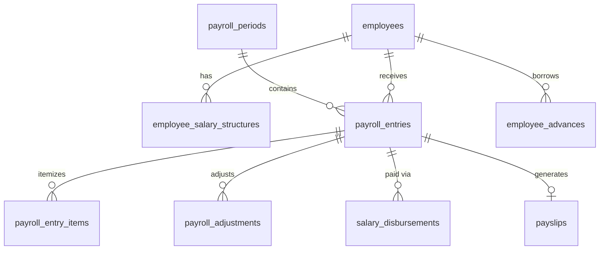
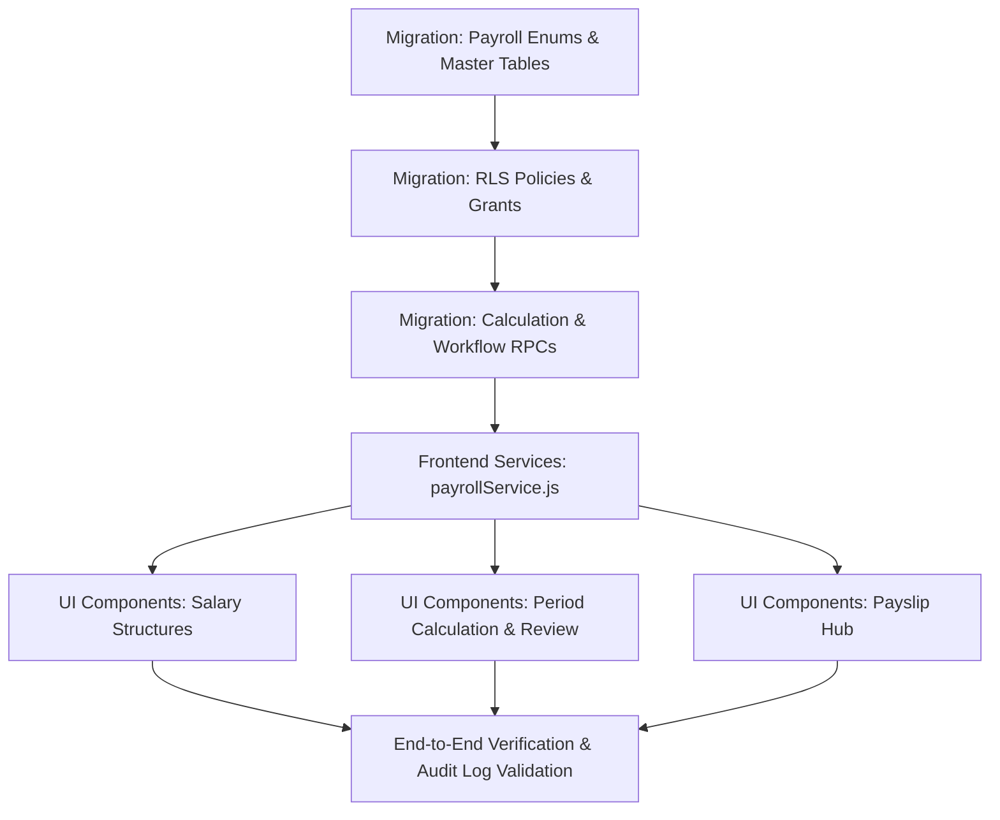

# Payroll Module Specification — ferrixOps

**Project:** ferrixOps
**Branch:** `feature/payroll-module`  
**Target Environment:** React (Vite) + Supabase (PostgreSQL 15+)  
**Date:** September 2026  
**Status:** SPECIFICATION & ARCHITECTURAL BLUEPRINT (Pre-Implementation)

---

## 1. Executive Summary

This document specifies the end-to-end architecture, database schema, security model, calculation engine, backend functions (RPCs), and frontend user experience for the **Payroll Module** of ferrixOps.

ferrixOps is deployed in an **aluminium manufacturing facility** where approximately 40 educated, smartphone-equipped staff members (plant managers, production supervisors, technical engineers, accountants, sales executives, and executive directors) use the system for daily work operations. Factory payroll requires absolute mathematical accuracy, non-repudiable audit logging, strict role segregation, and seamless interoperability with the existing **Employee Management**, **Attendance Management**, **Leave Management**, and **Bills & Expenses** modules.

### Core Objectives

1. **Mathematical Integrity:** Authoritative, server-side salary calculations that eliminate client-side manipulation risks.
2. **Operational Cohesion:** Direct ingestion of real daily attendance statuses (`PRESENT`, `HALF_DAY`, `ABSENT`, `LEAVE`, `INCOMPLETE`) and approved leaves into compensation math.
3. **Strict Role Separation:** Unbreakable barriers separating `OWNER` (governance, structure definition, final approval, locking), `ACCOUNTS` (period creation, calculation, validation, payment recording, payslip generation), and `EMPLOYEE` (read-only access to their own payslips and salary history).
4. **Historical Immutability:** Salary revisions, retroactive attendance corrections, or employee exits must never mutate historical payroll runs or finalized payslips.
5. **Zero Data Loss & Security Compliance:** Native PostgreSQL Row-Level Security (RLS) and `SECURITY DEFINER` transactional boundaries integrated with the existing `audit_logs` ledger.

---

## 2. Existing ferrixOps Schema Findings (Phase 1 Inspection)

A thorough inspection of the repository migrations (`supabase/migrations/`) and frontend codebase reveals the following existing database objects, relationships, and operational rules:

### A. Employee Management

- **Core Table:** `public.employees`
  - **Primary Key:** `id UUID PRIMARY KEY DEFAULT gen_random_uuid()`
  - **Auth Link:** `user_id UUID NOT NULL UNIQUE REFERENCES public.profiles(id) ON DELETE RESTRICT`
  - **Identity Columns:** `employee_code TEXT NOT NULL UNIQUE`, `first_name TEXT NOT NULL`, `last_name TEXT NOT NULL`, `company_email TEXT NOT NULL UNIQUE`, `phone_number TEXT`
  - **Organization Columns:** `department_id UUID NOT NULL REFERENCES public.departments(id)`, `designation_id UUID NOT NULL REFERENCES public.designations(id)`
  - **Employment Columns:** `joining_date DATE NOT NULL`, `employment_status public.employment_status NOT NULL DEFAULT 'ACTIVE'` (`'ACTIVE'`, `'INACTIVE'`, `'EXITED'`), `employment_type public.employment_type NOT NULL DEFAULT 'FULL_TIME'` (`'FULL_TIME'`, `'PART_TIME'`, `'CONTRACT'`, `'INTERN'`)
  - **Timestamps:** `created_at TIMESTAMPTZ`, `updated_at TIMESTAMPTZ` (maintained by `handle_updated_at` trigger)
- **Personal Info Table:** `public.employee_personal_info`
  - **Primary Key:** `id UUID PRIMARY KEY DEFAULT gen_random_uuid()`
  - **Foreign Key:** `employee_id UUID NOT NULL UNIQUE REFERENCES public.employees(id) ON DELETE RESTRICT`
  - **Fields:** `date_of_birth DATE NOT NULL`, `personal_phone TEXT NOT NULL`, `personal_email TEXT NOT NULL`, `address TEXT NOT NULL`, `emergency_contact TEXT NOT NULL`
- **Salary / Bank Details Status:** **None exist currently.** There are no bank account numbers, IFSC codes, PAN, salary figures, or compensation structures stored in `employees` or `employee_personal_info`. These must be introduced in the Payroll schema.
- **RLS Policies on Employees:**
  - `Employee reads own record` (`user_id = auth.uid()`)
  - `Privileged roles read all employees` (`public.get_my_role() IN ('OWNER', 'ACCOUNTS')`)
  - `Owner manages employees` (`public.get_my_role() = 'OWNER'`)
- **Existing Employee RPCs / Edge Functions:**
  - `update_employee_role(p_user_id UUID, p_new_role public.app_role)` (`SECURITY DEFINER`, OWNER only)
  - Edge Function: `create-employee` (creates Supabase Auth user, profile, employee, and personal info in an audited flow)
  - Edge Function: `update-employee-status` (updates `employment_status` with compensating ban logic)

### B. Attendance Management

- **Core Table:** `public.attendance_records`
  - **Primary Key:** `id UUID PRIMARY KEY DEFAULT gen_random_uuid()`
  - **Foreign Key:** `employee_id UUID NOT NULL REFERENCES public.employees(id) ON DELETE RESTRICT`
  - **Columns:** `attendance_date DATE NOT NULL`, `check_in_at TIMESTAMPTZ`, `check_out_at TIMESTAMPTZ`, `status public.attendance_status NOT NULL`, `source public.attendance_source NOT NULL DEFAULT 'SELF'`, `notes TEXT`
  - **Unique Constraint:** `CONSTRAINT unique_employee_attendance_day UNIQUE (employee_id, attendance_date)`
  - **Status Enum (`attendance_status`):** `'PRESENT'`, `'ABSENT'`, `'HALF_DAY'`, `'LEAVE'`, `'INCOMPLETE'`
  - **Source Enum (`attendance_source`):** `'SELF'`, `'MANUAL'`, `'CORRECTED'`
  - **Consistency Check Constraint (`attendance_status_consistency`):**
    - `PRESENT` and `HALF_DAY`: requires both `check_in_at` and `check_out_at` NOT NULL, with `check_out_at >= check_in_at`.
    - `INCOMPLETE`: requires `check_in_at` NOT NULL and `check_out_at` NULL.
    - `ABSENT` and `LEAVE`: requires both `check_in_at` and `check_out_at` NULL.
- **Correction Requests Table:** `public.attendance_correction_requests`
  - **Primary Key:** `id UUID PRIMARY KEY DEFAULT gen_random_uuid()`
  - **Foreign Key:** `attendance_record_id UUID NOT NULL REFERENCES public.attendance_records(id)`, `employee_id UUID NOT NULL REFERENCES public.employees(id)`
  - **Fields:** `requested_status`, `requested_check_in`, `requested_check_out`, `reason TEXT NOT NULL`, `status public.correction_status NOT NULL DEFAULT 'PENDING'` (`'PENDING'`, `'APPROVED'`, `'REJECTED'`), `reviewed_by UUID REFERENCES public.profiles(id)`, `reviewed_at TIMESTAMPTZ`, `review_remarks TEXT`
  - **Unique Partial Index:** Only one `PENDING` request per attendance record (`WHERE status = 'PENDING'`).
- **RLS Policies on Attendance:**
  - `Employee views own attendance` (`employee_id IN (SELECT id FROM employees WHERE user_id = auth.uid())`)
  - `Owner views all attendance` (`public.get_my_role() = 'OWNER'`)
  - `Accounts views all attendance` (`public.get_my_role() = 'ACCOUNTS'`)
- **Existing Attendance RPCs:**
  - `check_in()`: Server-side timestamp check-in (`status = 'INCOMPLETE'`)
  - `check_out()`: Server-side timestamp check-out (`status = 'PRESENT'`)
  - `request_attendance_correction(...)`: Employee initiates correction
  - `review_attendance_correction(...)`: OWNER approves/rejects; if approved, mutates `attendance_records` to `source = 'CORRECTED'`

### C. Leave Management

- **Core Table:** `public.leave_requests` (Migration `20260913000001_leave_management.sql`)
  - **Primary Key:** `id UUID PRIMARY KEY DEFAULT gen_random_uuid()`
  - **Foreign Key:** `employee_id UUID NOT NULL REFERENCES public.employees(id) ON DELETE RESTRICT`
  - **Columns:** `start_date DATE NOT NULL`, `end_date DATE NOT NULL`, `reason TEXT`, `status public.leave_status NOT NULL DEFAULT 'PENDING'`, `reviewed_by UUID REFERENCES public.profiles(id)`, `reviewed_at TIMESTAMPTZ`, `owner_remarks TEXT`
  - **Status Enum (`leave_status`):** `'PENDING'`, `'APPROVED'`, `'REJECTED'`, `'CANCELLED'`
- **Operational Mechanism:**
  - There is **no distinction between paid and unpaid leave** in the current schema.
  - When an OWNER calls `review_leave_request(..., p_approve = TRUE)`, the RPC iterates through `generate_series(start_date, end_date)` and inserts or updates `public.attendance_records` setting `status = 'LEAVE'` and `source = 'MANUAL'`.
  - If a date in the range already has attendance `PRESENT`, `HALF_DAY`, or `INCOMPLETE`, the approval aborts with an exception (`Attendance conflict`).
- **RLS Policies on Leave:**
  - `Employees view own leave requests`
  - `Owner views all leave requests`

### D. Bills & Expenses

- **Core Tables:** `public.expenses`, `public.expense_categories`, `public.expense_documents`, `public.payments`
- **Expense Workflow Status Enum (`expense_status`):** `'DRAFT'`, `'SUBMITTED'`, `'RETURNED_FOR_CORRECTION'`, `'PENDING_OWNER_APPROVAL'`, `'PAYMENT_PENDING'`, `'PAID'`, `'REJECTED_BY_ACCOUNTS'`, `'REJECTED_BY_OWNER'`
- **Payment Table (`public.payments`):**
  - `expense_id UUID NOT NULL UNIQUE REFERENCES public.expenses(id)` (1-to-1 with expense)
  - `payment_reference TEXT NOT NULL UNIQUE` (Generated: `PAY-YYYYMMDD-XXXX`)
  - `payment_amount NUMERIC(12, 2) NOT NULL CHECK (payment_amount > 0)`
  - `payment_date DATE NOT NULL DEFAULT CURRENT_DATE`
  - `payment_method public.payment_method NOT NULL` (`'BANK_TRANSFER'`, `'UPI'`, `'CHEQUE'`, `'CASH'`, `'OTHER'`)
  - `transaction_reference TEXT`, `recorded_by UUID NOT NULL REFERENCES public.profiles(id)`
- **Payroll Interaction:** Currently, **expenses and payments are completely decoupled from employee salaries**. The `payments` table has a strict foreign key constraint `REFERENCES public.expenses(id)`. Salary payments cannot be placed into `public.payments` without violating constraints; they require a dedicated payroll disbursement table.

### E. Existing Roles, Permissions & Security

- **Roles Enum (`app_role`):** `'OWNER'`, `'ACCOUNTS'`, `'EMPLOYEE'`
- **Role Verification:** `public.get_my_role()` is `STABLE SECURITY DEFINER SET search_path = ''` reading `role` from `public.profiles WHERE id = auth.uid()`.
- **Audit Logging:** `public.audit_logs` table stores an immutable log of system actions. Managed by `public.create_audit_log(p_actor_id, p_actor_role, p_action, p_entity_type, p_entity_id, p_previous_data, p_new_data)`. RLS grants OWNER full visibility, and ACCOUNTS visibility into financial logs.

---

## 3. Confirmed Assumptions & Factory Operational Realities

1. **Staff Scope:** The payroll system covers salaried factory staff, engineers, supervisors, sales, accounts, and managers (~40 users). Daily wage contract labor (paid on physical muster rolls) is out of scope for V1.
2. **Currency:** Primary currency is Indian Rupees (`INR`), formatted as `₹` with 2 decimal precision (stored as `NUMERIC(12, 2)`).
3. **Disbursement Channels:** Common factory payment methods include NEFT/RTGS Bank Transfer, Corporate UPI, Company Cheque, and occasional Petty Cash.
4. **Calendar Basis:** Standard manufacturing practice uses the calendar month (e.g., September 1 to September 30). The divisor for per-day calculation is configurable per policy (see Section 5).
5. **Loss of Pay (LOP) Principle:** In manufacturing, unexcused absence (`ABSENT`), unresolved incomplete punches (`INCOMPLETE`), and unpaid leaves directly reduce monthly earnings based on daily wage rates.
6. **Advances & Loans:** Factory staff frequently request salary advances for emergencies/festivals, recovered in equal installments from monthly payroll.

---

## 4. Open Questions & Owner Decisions Required

Before running live payroll, the factory Owner must confirm the following operational policies:

> [!IMPORTANT]
> **Owner Decision Item 1: Day Divisor for Daily Wage Calculation**
> _Option A (Actual Calendar Days):_ Daily Rate = Monthly Fixed CTC ÷ Total Days in Month (e.g., 30 in Sep, 31 in Oct, 28 in Feb). _Recommended for Indian manufacturing staff._  
> _Option B (Standard 30 Days):_ Daily Rate = Monthly Fixed CTC ÷ 30 every month.  
> _Option C (Actual Working Days):_ Daily Rate = Monthly Fixed CTC ÷ (Calendar Days minus Weekly Offs and Factory Holidays).  
> _Default Assumption in Spec:_ **Option A (Actual Calendar Days in the payroll month)**, with an override capability per payroll period.

> [!IMPORTANT]
> **Owner Decision Item 2: Statutory Deductions (PF, ESIC, Professional Tax, TDS)**
> Indian statutory deductions (Provident Fund at 12%, ESIC at 0.75%, State Professional Tax slabs, and Income Tax TDS) require formal government filing registrations.  
> _Current Finding:_ The existing system does not contain PF numbers, UAN, ESIC codes, or tax regime elections.  
> _Decision:_ In MVP, statutory deductions are configured as **optional user-defined deduction components**. Automatic statutory calculation engines are scoped for Phase 2.

> [!IMPORTANT]
> **Owner Decision Item 3: Expense Reimbursement Integration into Payroll**
> _Option A (Separate Disbursal):_ Approved expenses remain paid independently via the existing Bills & Expenses module through `record_payment()`.  
> _Option B (Consolidated in Payroll):_ Approved unpaid expenses can be pulled into monthly payroll as a non-taxable reimbursement line item.  
> _Decision:_ In MVP, **Option A** is maintained to prevent schema collisions with the existing `payments` table. Option B is documented as a Phase 2 feature.

---

## 5. Functional Requirements

### 1. Payroll Period Lifecycle

- Monthly payroll cycles (e.g., `2026-09-01` to `2026-09-30`).
- Lifecycle states:
  1. `DRAFT`: Period created by ACCOUNTS or OWNER; date bounds defined.
  2. `CALCULATING`: Server process batch-evaluates attendance and components.
  3. `CALCULATED`: Calculation complete; draft line items and exceptions available for review.
  4. `PENDING_APPROVAL`: ACCOUNTS submits calculated period for OWNER review.
  5. `APPROVED`: OWNER approves the gross and net numbers.
  6. `LOCKED`: Period frozen. No calculation or adjustment can be changed.
  7. `PAID`: All salary disbursement records created and verified.
  8. `CLOSED`: Operational cycle completed and archived.
  9. `CANCELLED`: Voided run (only possible before `APPROVED`).
- **Reopening Policy:** A locked period **cannot** be modified. If an error is discovered in a locked/approved period, only the `OWNER` can execute a `reopen_payroll_period()` RPC, requiring mandatory documented reasons written to `audit_logs`.

### 2. Flexible Salary Structures

Support base compensation and customized factory allowances:

- **Earnings:**
  - `Basic Salary` (Fixed, recurring, taxable base)
  - `House Rent Allowance (HRA)` (Fixed, recurring)
  - `Conveyance Allowance` (Fixed, recurring)
  - `Special / Plant Allowance` (Fixed, recurring factory floor allowance)
  - `Overtime Pay` (Variable, attendance/hour-derived or manual)
  - `Performance Incentive / Production Bonus` (One-time or variable)
- **Deductions:**
  - `Loss of Pay (LOP) / Absence Deduction` (Calculated from attendance)
  - `Half-Day Deduction` (Calculated from attendance)
  - `Unpaid Leave Deduction` (Calculated from leave records)
  - `Salary Advance Recovery` (Recurring or one-time installment)
  - `TDS / Income Tax Withholding` (Optional fixed/manual deduction)
  - `Provident Fund (PF)` (Optional fixed percentage/amount)
  - `Other Deductions` (Safety gear, penalties, canteen, etc.)

### 3. Attendance & Leave Integration

For each employee in the active payroll period (`P_START` to `P_END`):

- **Calendar Days ($CD$):** Total days in period month ($P\_END - P\_START + 1$).
- **Present Days ($P$):** Count of `attendance_records` where `status = 'PRESENT'`.
- **Half Days ($HD$):** Count of `attendance_records` where `status = 'HALF_DAY'`.
- **Approved Leave Days ($L$):** Count of `attendance_records` where `status = 'LEAVE'`. (Distinguished into Paid vs Unpaid per employee leave quota rules).
- **Incomplete Days ($INC$):** Count of `attendance_records` where `status = 'INCOMPLETE'` without resolved checkout.
- **Absent Days ($A$):** Count of days with `status = 'ABSENT'` PLUS unrecorded missing calendar days between the employee's `joining_date` and the period end.
- **Payable Days ($PD$):**
  $$PD = P + (HD \times 0.5) + \text{Paid Leave Days} + \text{Eligible Weekly Offs}$$
- **Deduction Days ($DD$):**
  $$DD = CD - PD$$
  _(Where $DD = A + INC + (HD \times 0.5) + \text{Unpaid Leave Days}$)_

### 4. Overtime & Factory Shift Work

- Factory operations occasionally require extra supervisory shifts during furnace maintenance or weekend pour cycles.
- Overtime is calculated based on approved hours or recorded as an approved adjustment line item before locking.

### 5. Salary Advances & Loan Ledger

- Ability to record an advance granted to an employee (`amount`, `disbursement_date`, `monthly_installment`).
- Automatic inclusion of the monthly installment in payroll deductions until the outstanding balance reaches zero.

### 6. Salary Disbursement & Payment Recording

- Decoupled from the expense `payments` table.
- Records individual disbursement transactions: `payroll_entry_id`, `payment_amount`, `payment_date`, `payment_method` (`BANK_TRANSFER`, `UPI`, `CHEQUE`, `CASH`), `transaction_reference`, `recorded_by`, and `notes`.
- Supports full and partial payment states (`UNPAID`, `PARTIALLY_PAID`, `PAID`).

### 7. Digital Payslips

- Immutable, downloadable, and printable payslip generated upon payroll locking.
- Comprehensive display of earnings, deductions, attendance summary, net payout, payment reference, and plant corporate header.

---

## 6. Role Permissions Matrix

| Operation                                             |      OWNER      |       ACCOUNTS        |      EMPLOYEE       |
| :---------------------------------------------------- | :-------------: | :-------------------: | :-----------------: |
| **Manage Salary Structures / Assign to Employees**    |   Full Access   |       View Only       |      Forbidden      |
| **Create Payroll Period**                             |   Full Access   |      Full Access      |      Forbidden      |
| **Trigger Payroll Calculation / Recalculation**       |   Full Access   |      Full Access      |      Forbidden      |
| **Add Manual Adjustments (Bonus, Penalty, Overtime)** |   Full Access   | Create (Needs Review) |      Forbidden      |
| **Review Calculation Exceptions & Flagged Records**   |   Full Access   |      Full Access      |      Forbidden      |
| **Submit Period for Approval**                        |   Full Access   |      Full Access      |      Forbidden      |
| **Approve Payroll Period**                            | **Full Access** |     **Forbidden**     |      Forbidden      |
| **Lock Payroll Period**                               | **Full Access** |     **Forbidden**     |      Forbidden      |
| **Reopen / Unlock Payroll Period**                    | **Full Access** |     **Forbidden**     |      Forbidden      |
| **Record Salary Payments**                            |   Full Access   |      Full Access      |      Forbidden      |
| **Generate & Publish Payslips**                       |   Full Access   |      Full Access      |      Forbidden      |
| **View All Employee Payslips & Reports**              |   Full Access   |      Full Access      |      Forbidden      |
| **View Own Payslip & Payment Status**                 |   Full Access   |      Full Access      | **Own Record Only** |
| **Export Bank Transfer NEFT Advice / Cash Sheets**    |   Full Access   |      Full Access      |      Forbidden      |

---

## 7. Payroll Calculation Rules & Formulas

### Mathematical Foundation

#### 1. Daily Salary Rate ($R_{day}$)

Using actual calendar days ($CD$) in the period:
$$R_{day} = \frac{\text{Monthly Fixed Gross Salary}}{CD}$$

#### 2. Loss of Pay (LOP) Deduction ($D_{lop}$)

$$D_{lop} = R_{day} \times \left( \text{Absent Days} + \text{Incomplete Days} + \text{Unpaid Leave Days} + (0.5 \times \text{Half Days}) \right)$$

#### 3. Gross Earnings ($E_{gross}$)

$$E_{gross} = \text{Base Salary} + \text{HRA} + \text{Conveyance} + \text{Special Allowance} + \text{Overtime Pay} + \text{Bonus/Incentive}$$

#### 4. Total Deductions ($D_{total}$)

$$D_{total} = D_{lop} + \text{Salary Advance Installment} + \text{Statutory / Tax Deductions} + \text{Manual Penalties}$$

#### 5. Net Payable Salary ($S_{net}$)

$$S_{net} = \max\left(0, \text{ROUND}(E_{gross} - D_{total}, 0)\right)$$

### Edge Case Handling Rules

1. **Negative Net Salary:** If deductions exceed gross earnings, $S_{net}$ is clamped to $0$. The unrecovered deduction deficit is automatically converted into an outstanding advance balance carried forward to the next period.
2. **Mid-Month Joiners:** If an employee joined on September 16, days from September 1 to September 15 are classified as `PRE_JOINING_DAYS` and excluded from payable days without triggering disciplinary absence penalties.
3. **Mid-Month Exits:** If an employee exit date falls within the period, days following the exit date are classified as `POST_EXIT_DAYS` and excluded from calculations.
4. **Rounding:** All final net payable amounts are rounded to the nearest integer (`ROUND(val, 0)`), conforming to Indian banking norms.

---

## 8. Proposed Database Design

The Payroll Module introduces **8 tightly integrated tables** following the existing naming conventions, primary key patterns (`UUID DEFAULT gen_random_uuid()`), timestamp triggers (`handle_updated_at()`), and RLS standards.



### Table 1: `public.payroll_periods`

Manages the monthly payroll processing cycles.

```sql
CREATE TYPE public.payroll_period_status AS ENUM (
    'DRAFT',
    'CALCULATING',
    'CALCULATED',
    'PENDING_APPROVAL',
    'APPROVED',
    'LOCKED',
    'CLOSED',
    'CANCELLED'
);

CREATE TABLE public.payroll_periods (
    id UUID PRIMARY KEY DEFAULT gen_random_uuid(),
    period_name TEXT NOT NULL UNIQUE,          -- e.g. "September 2026"
    start_date DATE NOT NULL,                  -- e.g. "2026-09-01"
    end_date DATE NOT NULL,                    -- e.g. "2026-09-30"
    processing_date DATE NOT NULL DEFAULT CURRENT_DATE,
    status public.payroll_period_status NOT NULL DEFAULT 'DRAFT',
    total_gross_amount NUMERIC(14, 2) NOT NULL DEFAULT 0.00,
    total_deductions_amount NUMERIC(14, 2) NOT NULL DEFAULT 0.00,
    total_net_amount NUMERIC(14, 2) NOT NULL DEFAULT 0.00,
    total_employees_count INTEGER NOT NULL DEFAULT 0,
    approved_by UUID REFERENCES public.profiles(id) ON DELETE RESTRICT,
    approved_at TIMESTAMPTZ,
    locked_by UUID REFERENCES public.profiles(id) ON DELETE RESTRICT,
    locked_at TIMESTAMPTZ,
    reopened_by UUID REFERENCES public.profiles(id) ON DELETE RESTRICT,
    reopened_at TIMESTAMPTZ,
    reopen_reason TEXT,
    created_by UUID NOT NULL REFERENCES public.profiles(id) ON DELETE RESTRICT,
    created_at TIMESTAMPTZ NOT NULL DEFAULT CURRENT_TIMESTAMP,
    updated_at TIMESTAMPTZ NOT NULL DEFAULT CURRENT_TIMESTAMP,
    CONSTRAINT payroll_period_dates_valid CHECK (start_date <= end_date)
);

CREATE TRIGGER payroll_periods_updated_at
BEFORE UPDATE ON public.payroll_periods
FOR EACH ROW EXECUTE FUNCTION public.handle_updated_at();

CREATE INDEX idx_payroll_periods_dates ON public.payroll_periods(start_date, end_date);
CREATE INDEX idx_payroll_periods_status ON public.payroll_periods(status);
```

### Table 2: `public.employee_salary_structures`

Maintains versioned compensation packages for each employee. Historical records are preserved when compensation changes.

```sql
CREATE TABLE public.employee_salary_structures (
    id UUID PRIMARY KEY DEFAULT gen_random_uuid(),
    employee_id UUID NOT NULL REFERENCES public.employees(id) ON DELETE RESTRICT,
    effective_from DATE NOT NULL,
    effective_to DATE,                         -- NULL indicates current active structure
    basic_salary NUMERIC(12, 2) NOT NULL CHECK (basic_salary >= 0),
    hra NUMERIC(12, 2) NOT NULL DEFAULT 0.00 CHECK (hra >= 0),
    conveyance_allowance NUMERIC(12, 2) NOT NULL DEFAULT 0.00 CHECK (conveyance_allowance >= 0),
    special_allowance NUMERIC(12, 2) NOT NULL DEFAULT 0.00 CHECK (special_allowance >= 0),
    other_allowances NUMERIC(12, 2) NOT NULL DEFAULT 0.00 CHECK (other_allowances >= 0),
    gross_salary NUMERIC(12, 2) GENERATED ALWAYS AS (
        basic_salary + hra + conveyance_allowance + special_allowance + other_allowances
    ) STORED,
    -- Banking details (Required for factory salary disbursements)
    bank_name TEXT,
    bank_account_number TEXT,
    bank_ifsc_code TEXT,
    pan_number TEXT,
    is_active BOOLEAN NOT NULL DEFAULT TRUE,
    created_by UUID NOT NULL REFERENCES public.profiles(id) ON DELETE RESTRICT,
    created_at TIMESTAMPTZ NOT NULL DEFAULT CURRENT_TIMESTAMP,
    updated_at TIMESTAMPTZ NOT NULL DEFAULT CURRENT_TIMESTAMP,
    CONSTRAINT chk_salary_effective_dates CHECK (effective_to IS NULL OR effective_from <= effective_to)
);

CREATE TRIGGER employee_salary_structures_updated_at
BEFORE UPDATE ON public.employee_salary_structures
FOR EACH ROW EXECUTE FUNCTION public.handle_updated_at();

CREATE INDEX idx_emp_salary_employee ON public.employee_salary_structures(employee_id);
CREATE INDEX idx_emp_salary_active ON public.employee_salary_structures(employee_id, is_active) WHERE is_active = TRUE;
```

### Table 3: `public.payroll_entries`

The master record per employee per payroll period. Stores calculated aggregates and attendance metrics.

```sql
CREATE TYPE public.payroll_entry_payment_status AS ENUM (
    'UNPAID',
    'PARTIALLY_PAID',
    'PAID'
);

CREATE TABLE public.payroll_entries (
    id UUID PRIMARY KEY DEFAULT gen_random_uuid(),
    payroll_period_id UUID NOT NULL REFERENCES public.payroll_periods(id) ON DELETE RESTRICT,
    employee_id UUID NOT NULL REFERENCES public.employees(id) ON DELETE RESTRICT,
    salary_structure_id UUID NOT NULL REFERENCES public.employee_salary_structures(id) ON DELETE RESTRICT,
    -- Attendance Metrics Snapshot
    calendar_days INTEGER NOT NULL CHECK (calendar_days > 0),
    present_days NUMERIC(4, 1) NOT NULL DEFAULT 0 CHECK (present_days >= 0),
    half_days INTEGER NOT NULL DEFAULT 0 CHECK (half_days >= 0),
    absent_days INTEGER NOT NULL DEFAULT 0 CHECK (absent_days >= 0),
    leave_days INTEGER NOT NULL DEFAULT 0 CHECK (leave_days >= 0),
    incomplete_days INTEGER NOT NULL DEFAULT 0 CHECK (incomplete_days >= 0),
    payable_days NUMERIC(4, 1) NOT NULL CHECK (payable_days >= 0),
    -- Financials
    daily_rate NUMERIC(12, 4) NOT NULL CHECK (daily_rate >= 0),
    base_gross_earnings NUMERIC(12, 2) NOT NULL DEFAULT 0.00,
    gross_earnings NUMERIC(12, 2) NOT NULL DEFAULT 0.00,
    attendance_deductions NUMERIC(12, 2) NOT NULL DEFAULT 0.00,
    advance_deductions NUMERIC(12, 2) NOT NULL DEFAULT 0.00,
    other_deductions NUMERIC(12, 2) NOT NULL DEFAULT 0.00,
    total_deductions NUMERIC(12, 2) NOT NULL DEFAULT 0.00,
    net_salary NUMERIC(12, 2) NOT NULL DEFAULT 0.00,
    payment_status public.payroll_entry_payment_status NOT NULL DEFAULT 'UNPAID',
    has_exceptions BOOLEAN NOT NULL DEFAULT FALSE,
    exception_notes TEXT,
    created_at TIMESTAMPTZ NOT NULL DEFAULT CURRENT_TIMESTAMP,
    updated_at TIMESTAMPTZ NOT NULL DEFAULT CURRENT_TIMESTAMP,
    CONSTRAINT unique_employee_payroll_period UNIQUE (payroll_period_id, employee_id)
);

CREATE TRIGGER payroll_entries_updated_at
BEFORE UPDATE ON public.payroll_entries
FOR EACH ROW EXECUTE FUNCTION public.handle_updated_at();

CREATE INDEX idx_payroll_entries_period ON public.payroll_entries(payroll_period_id);
CREATE INDEX idx_payroll_entries_employee ON public.payroll_entries(employee_id);
CREATE INDEX idx_payroll_entries_payment_status ON public.payroll_entries(payment_status);
```

### Table 4: `public.payroll_entry_items`

Detailed line-item breakdown for earnings and deductions on each employee's payroll entry.

```sql
CREATE TYPE public.payroll_item_type AS ENUM (
    'EARNING',
    'DEDUCTION',
    'REIMBURSEMENT'
);

CREATE TABLE public.payroll_entry_items (
    id UUID PRIMARY KEY DEFAULT gen_random_uuid(),
    payroll_entry_id UUID NOT NULL REFERENCES public.payroll_entries(id) ON DELETE CASCADE,
    item_type public.payroll_item_type NOT NULL,
    component_name TEXT NOT NULL,              -- e.g. "Basic Salary", "HRA", "LOP Deduction"
    amount NUMERIC(12, 2) NOT NULL CHECK (amount >= 0),
    calculation_notes TEXT,                    -- e.g. "1.5 days LOP @ ₹1,200.00/day"
    is_manual BOOLEAN NOT NULL DEFAULT FALSE,
    created_at TIMESTAMPTZ NOT NULL DEFAULT CURRENT_TIMESTAMP
);

CREATE INDEX idx_payroll_items_entry ON public.payroll_entry_items(payroll_entry_id);
```

### Table 5: `public.payroll_adjustments`

Audited manual additions or deductions applied to a payroll entry prior to approval.

```sql
CREATE TABLE public.payroll_adjustments (
    id UUID PRIMARY KEY DEFAULT gen_random_uuid(),
    payroll_entry_id UUID NOT NULL REFERENCES public.payroll_entries(id) ON DELETE CASCADE,
    item_type public.payroll_item_type NOT NULL,
    component_name TEXT NOT NULL,              -- e.g. "Furnace Overtime", "Safety Penalty"
    amount NUMERIC(12, 2) NOT NULL CHECK (amount > 0),
    reason TEXT NOT NULL,
    created_by UUID NOT NULL REFERENCES public.profiles(id) ON DELETE RESTRICT,
    created_at TIMESTAMPTZ NOT NULL DEFAULT CURRENT_TIMESTAMP
);

CREATE INDEX idx_payroll_adjustments_entry ON public.payroll_adjustments(payroll_entry_id);
```

### Table 6: `public.employee_advances`

Tracks loans and salary advances granted to staff and their monthly repayment schedule.

```sql
CREATE TYPE public.advance_status AS ENUM (
    'PENDING',
    'APPROVED',
    'DISBURSED',
    'REPAID',
    'CANCELLED'
);

CREATE TABLE public.employee_advances (
    id UUID PRIMARY KEY DEFAULT gen_random_uuid(),
    employee_id UUID NOT NULL REFERENCES public.employees(id) ON DELETE RESTRICT,
    principal_amount NUMERIC(12, 2) NOT NULL CHECK (principal_amount > 0),
    monthly_installment NUMERIC(12, 2) NOT NULL CHECK (monthly_installment > 0),
    balance_amount NUMERIC(12, 2) NOT NULL CHECK (balance_amount >= 0),
    disbursement_date DATE,
    reason TEXT NOT NULL,
    status public.advance_status NOT NULL DEFAULT 'PENDING',
    approved_by UUID REFERENCES public.profiles(id) ON DELETE RESTRICT,
    approved_at TIMESTAMPTZ,
    created_by UUID NOT NULL REFERENCES public.profiles(id) ON DELETE RESTRICT,
    created_at TIMESTAMPTZ NOT NULL DEFAULT CURRENT_TIMESTAMP,
    updated_at TIMESTAMPTZ NOT NULL DEFAULT CURRENT_TIMESTAMP
);

CREATE TRIGGER employee_advances_updated_at
BEFORE UPDATE ON public.employee_advances
FOR EACH ROW EXECUTE FUNCTION public.handle_updated_at();

CREATE INDEX idx_advances_employee ON public.employee_advances(employee_id);
CREATE INDEX idx_advances_status ON public.employee_advances(status);
```

### Table 7: `public.salary_disbursements`

Records monetary transactions for salary payments. Completely separate from the expense payments table.

```sql
CREATE TABLE public.salary_disbursements (
    id UUID PRIMARY KEY DEFAULT gen_random_uuid(),
    payroll_entry_id UUID NOT NULL REFERENCES public.payroll_entries(id) ON DELETE RESTRICT,
    disbursement_reference TEXT NOT NULL UNIQUE, -- Generated: SAL-YYYYMMDD-XXXX
    amount NUMERIC(12, 2) NOT NULL CHECK (amount > 0),
    disbursement_date DATE NOT NULL DEFAULT CURRENT_DATE,
    payment_method public.payment_method NOT NULL,
    transaction_reference TEXT,                -- Bank UTR, UPI Ref, Cheque No
    recorded_by UUID NOT NULL REFERENCES public.profiles(id) ON DELETE RESTRICT,
    notes TEXT,
    created_at TIMESTAMPTZ NOT NULL DEFAULT CURRENT_TIMESTAMP
);

CREATE INDEX idx_disbursements_entry ON public.salary_disbursements(payroll_entry_id);
CREATE INDEX idx_disbursements_date ON public.salary_disbursements(disbursement_date DESC);
```

### Table 8: `public.payslips`

Read-only metadata and publication records for employee payslips.

```sql
CREATE TABLE public.payslips (
    id UUID PRIMARY KEY DEFAULT gen_random_uuid(),
    payroll_entry_id UUID NOT NULL UNIQUE REFERENCES public.payroll_entries(id) ON DELETE RESTRICT,
    payslip_number TEXT NOT NULL UNIQUE,       -- Generated: SLIP-YYYYMM-XXXX
    is_published BOOLEAN NOT NULL DEFAULT FALSE,
    published_at TIMESTAMPTZ,
    published_by UUID REFERENCES public.profiles(id) ON DELETE RESTRICT,
    created_at TIMESTAMPTZ NOT NULL DEFAULT CURRENT_TIMESTAMP
);

CREATE INDEX idx_payslips_entry ON public.payslips(payroll_entry_id);
```

---

## 9. Row-Level Security (RLS) & Security Architecture

Following ferrixOps’s security pattern, RLS is enabled on all tables with a **default-deny** policy for mutations. Direct table `INSERT`, `UPDATE`, and `DELETE` queries from frontend clients are blocked. All business transitions occur exclusively through `SECURITY DEFINER` RPCs.

### RLS Policies Summary

1. **`payroll_periods`**
   - `SELECT`: All authenticated users can read periods (`TRUE`) to display period selectors and status badges.
   - `INSERT/UPDATE/DELETE`: None. Restricted to `SECURITY DEFINER` RPCs.
2. **`employee_salary_structures`**
   - `SELECT`: OWNER and ACCOUNTS can view all structures (`public.get_my_role() IN ('OWNER', 'ACCOUNTS')`). EMPLOYEE can only view their own active structure (`employee_id IN (SELECT id FROM employees WHERE user_id = auth.uid())`).
   - `INSERT/UPDATE/DELETE`: None. Managed via `set_employee_salary_structure()` RPC.
3. **`payroll_entries` & `payroll_entry_items`**
   - `SELECT`: OWNER and ACCOUNTS view all entries. EMPLOYEE can view entries only when their associated `payslips.is_published = TRUE` and `employee_id` belongs to `auth.uid()`.
   - `INSERT/UPDATE/DELETE`: None. Restricted to calculation RPCs.
4. **`payroll_adjustments`**
   - `SELECT`: OWNER and ACCOUNTS view all. EMPLOYEE cannot view adjustments directly (they see consolidated line items on published payslips).
   - `INSERT/UPDATE/DELETE`: None. Managed via `add_payroll_adjustment()` RPC.
5. **`employee_advances`**
   - `SELECT`: OWNER and ACCOUNTS view all. EMPLOYEE views their own advances.
   - `INSERT/UPDATE/DELETE`: None. Managed via RPCs.
6. **`salary_disbursements`**
   - `SELECT`: OWNER and ACCOUNTS view all. EMPLOYEE views disbursements linked to their own entries.
   - `INSERT/UPDATE/DELETE`: None. Managed via `record_salary_disbursement()` RPC.
7. **`payslips`**
   - `SELECT`: OWNER and ACCOUNTS view all. EMPLOYEE views published payslips (`is_published = TRUE AND payroll_entry_id IN (SELECT id FROM payroll_entries WHERE employee_id IN (SELECT id FROM employees WHERE user_id = auth.uid()))`).

---

## 10. Backend Functions & RPC Design

Every privileged operation is executed by a hardened PostgreSQL `SECURITY DEFINER` function with `SET search_path = ''`, role verification, transaction isolation, and mandatory calls to `public.create_audit_log`.

### 1. `create_payroll_period`

- **Signature:** `create_payroll_period(p_period_name TEXT, p_start_date DATE, p_end_date DATE) RETURNS public.payroll_periods`
- **Access:** `OWNER`, `ACCOUNTS`
- **Validation:** Dates must not overlap existing active periods. Start date must be $\le$ End date.
- **Audit Action:** `PAYROLL_PERIOD_CREATED`

### 2. `set_employee_salary_structure`

- **Signature:** `set_employee_salary_structure(p_employee_id UUID, p_effective_from DATE, p_basic NUMERIC, p_hra NUMERIC, p_conveyance NUMERIC, p_special NUMERIC, p_other NUMERIC, p_bank_name TEXT, p_account_no TEXT, p_ifsc TEXT, p_pan TEXT) RETURNS public.employee_salary_structures`
- **Access:** `OWNER` only. (ACCOUNTS is rejected with an exception).
- **Behavior:** Retires any existing active structure by setting `effective_to = p_effective_from - INTERVAL '1 day'` and `is_active = FALSE`, then inserts the new record.
- **Audit Action:** `SALARY_STRUCTURE_UPDATED`

### 3. `calculate_payroll`

- **Signature:** `calculate_payroll(p_period_id UUID) RETURNS JSONB`
- **Access:** `OWNER`, `ACCOUNTS`
- **Behavior:**
  1. Validates that period is in `DRAFT` or `CALCULATED` status. If `APPROVED` or `LOCKED`, raises `Cannot recalculate approved or locked payroll`.
  2. Sets status to `CALCULATING`.
  3. Iterates over all active employees (`employment_status = 'ACTIVE'`).
  4. Fetches active `employee_salary_structures`. If missing, flags an exception on the entry and skips financial calculation.
  5. Computes attendance counts from `attendance_records` within `[start_date, end_date]`.
  6. Calculates LOP deductions, advance recovery installments, and net salary.
  7. Inserts or updates `payroll_entries` and `payroll_entry_items`.
  8. Updates period summary totals (`total_gross_amount`, `total_net_amount`, `total_employees_count`).
  9. Sets status to `CALCULATED`.
- **Audit Action:** `PAYROLL_CALCULATED`

### 4. `add_payroll_adjustment`

- **Signature:** `add_payroll_adjustment(p_payroll_entry_id UUID, p_type public.payroll_item_type, p_component_name TEXT, p_amount NUMERIC, p_reason TEXT) RETURNS public.payroll_adjustments`
- **Access:** `OWNER`, `ACCOUNTS`
- **Validation:** Period must be in `CALCULATED` or `PENDING_APPROVAL` status. Fails if period is `LOCKED` or `APPROVED`.
- **Behavior:** Inserts adjustment, recalculates the parent entry's `gross_earnings`, `total_deductions`, and `net_salary`.
- **Audit Action:** `PAYROLL_ADJUSTMENT_ADDED`

### 5. `submit_payroll_for_approval`

- **Signature:** `submit_payroll_for_approval(p_period_id UUID) RETURNS public.payroll_periods`
- **Access:** `ACCOUNTS`, `OWNER`
- **Validation:** Period must be in `CALCULATED` state with zero blocking errors.
- **Behavior:** Moves status to `PENDING_APPROVAL`.
- **Audit Action:** `PAYROLL_SUBMITTED_FOR_APPROVAL`

### 6. `review_payroll_approval`

- **Signature:** `review_payroll_approval(p_period_id UUID, p_approve BOOLEAN, p_remarks TEXT DEFAULT NULL) RETURNS public.payroll_periods`
- **Access:** `OWNER` only. (`ACCOUNTS` rejected with `Access denied`).
- **Behavior:** If `p_approve = TRUE`, sets status to `APPROVED`, records `approved_by` and `approved_at`. If `FALSE`, returns period to `CALCULATED` with rejection remarks.
- **Audit Action:** `PAYROLL_APPROVED` or `PAYROLL_REJECTED`

### 7. `lock_payroll_period`

- **Signature:** `lock_payroll_period(p_period_id UUID) RETURNS public.payroll_periods`
- **Access:** `OWNER` only.
- **Behavior:**
  1. Verifies status is `APPROVED`.
  2. Sets status to `LOCKED`, records `locked_by` and `locked_at`.
  3. Creates `payslips` records for all entries and marks them `is_published = TRUE`.
  4. Deducts active `employee_advances` installments from their balances.
- **Audit Action:** `PAYROLL_LOCKED`

### 8. `record_salary_disbursement`

- **Signature:** `record_salary_disbursement(p_payroll_entry_id UUID, p_amount NUMERIC, p_date DATE, p_method public.payment_method, p_reference TEXT, p_notes TEXT) RETURNS public.salary_disbursements`
- **Access:** `ACCOUNTS`, `OWNER`
- **Validation:** Period must be `LOCKED` or `APPROVED`. Amount must not exceed outstanding balance on entry.
- **Behavior:** Inserts into `salary_disbursements`, updates entry `payment_status` (`PAID` or `PARTIALLY_PAID`).
- **Audit Action:** `SALARY_DISBURSED`

### 9. `reopen_payroll_period`

- **Signature:** `reopen_payroll_period(p_period_id UUID, p_reason TEXT) RETURNS public.payroll_periods`
- **Access:** `OWNER` only.
- **Validation:** Cannot reopen if disbursements have already been recorded. Requires non-empty reason.
- **Behavior:** Moves status back to `CALCULATED`, unpublishes payslips, reverts advance balances.
- **Audit Action:** `PAYROLL_REOPENED`

---

## 11. Frontend Module Specification

The frontend module follows the existing React + Vite + Tailwind CSS + Radix UI architecture, adhering strictly to the **ferrixOps Ops Console design system** (coral/cyan/lime/amber/violet accent tokens, sleek dark mode, and accessible primitives).

### Navigation & Routing

Add the following routes in `src/App.jsx` and `src/components/layout/Sidebar.jsx`:

- `/payroll` — Main Payroll Hub (Role-aware dashboard)
- `/payroll/periods/:periodId` — Period Calculation & Review Workspace
- `/payroll/structures` — Employee Salary Structure Management (`OWNER`, `ACCOUNTS`)
- `/payroll/advances` — Salary Advance Ledger (`OWNER`, `ACCOUNTS`)
- `/payroll/payslips` — Employee Self-Service My Payslips (`EMPLOYEE`, `ACCOUNTS`, `OWNER`)

### Screen 1: Payroll Management Workspace (OWNER & ACCOUNTS)

- **Header:** Title "Payroll Management", Subtitle "Manage factory payroll runs, salary calculations, and disbursements", Icon `Banknote`, Tone `emerald`.
- **Stat Cards:**
  - Active Period Status (`Draft`, `Under Review`, `Approved`, `Locked`)
  - Total Gross Payroll (`₹XX,XX,XXX`)
  - Attendance Deductions (`₹XX,XXX`)
  - Net Disbursal (`₹XX,XX,XXX`)
- **Tabs:**
  1. `Payroll Periods`: Table listing periods with progress badges, total employees, net amount, and action buttons (`Calculate`, `Review`, `Approve`, `Lock`, `View`).
  2. `Salary Structures`: Directory of employees showing active Gross CTC, Basic, Allowances, and Bank Account status. Clicking opens `SalaryStructureDialog.jsx`.
  3. `Advances & Loans`: Ledger of outstanding advances with repayment progress bars.
- **States:** Full support for Skeleton loaders, Empty states ("No payroll periods created"), and Error toasts.

### Screen 2: Period Calculation & Review View (`/payroll/periods/:periodId`)

- **Overview:** Period metadata banner with status indicator and workflow action bar:
  - ACCOUNTS see: `Recalculate`, `Add Adjustment`, `Submit for Approval`.
  - OWNER sees: `Approve Payroll`, `Reject`, `Lock Period`, `Reopen Period`.
- **Exceptions Banner:** Highlights flagged anomalies (e.g., "3 employees have missing salary structures", "2 employees have incomplete punch records").
- **Employee Calculation Table:**
  - Columns: Code, Employee Name, Department, Base Gross, Payable Days, LOP Deduction, Adjustments, Net Salary, Status, Actions.
  - Expanding a row reveals the itemized calculation card (`Base Salary`, `HRA`, `Conveyance`, `Absence Deduction breakdown`, `Advance Deduction`).
- **Actions:** `Add Adjustment` button opens dialog with input for type (`EARNING` / `DEDUCTION`), amount, and mandatory audit reason.

### Screen 3: Salary Disbursement Console (ACCOUNTS & OWNER)

- **Overview:** Available once a period is `LOCKED`.
- **Export Actions:**
  - `Download Bank NEFT Advice (CSV)`: Pre-formatted file containing Account Name, Account Number, IFSC, and Net Amount for batch upload to corporate banking portals (SBI, HDFC, ICICI).
  - `Print Cash Payout Sheet`: Physical signature sheet for factory staff receiving cash disbursements.
- **Recording Modal:** Form to record batch or individual payment reference numbers (`UTR`, Cheque number, Date, Method).

### Screen 4: Employee Self-Service Payslip Hub (`/payroll/payslips`)

- **Role:** Available to `EMPLOYEE` (restricted to own records via RLS) and privileged roles.
- **Layout:**
  - Year/Month selector.
  - Summary cards showing `Net Take-Home Pay`, `Payable Days`, and `Payment Status`.
  - **Interactive Payslip Document:** Fully styled, printable PDF-like document featuring factory corporate header, employee code, designation, department, PAN, bank account mask (`XXXX-XXXX-1234`), attendance breakdown table, earnings vs deductions grid, and net pay in figures and words.

---

## 12. Validation & Exception Handling Matrix

|   #    | Exception / Scenario              | Trigger Condition                                              |   Severity   | System Behavior                                                                      | User Feedback / Resolution                                                                   |
| :----: | :-------------------------------- | :------------------------------------------------------------- | :----------: | :----------------------------------------------------------------------------------- | :------------------------------------------------------------------------------------------- |
| **1**  | **Missing Salary Structure**      | Active employee has no record in `employee_salary_structures`. | **BLOCKING** | Calculation sets `has_exceptions = TRUE`, net salary = 0. Period cannot be approved. | Warning badge: "No active salary structure found. Assign salary before proceeding."          |
| **2**  | **Incomplete Attendance Punches** | `attendance_records.status = 'INCOMPLETE'` on a workday.       | **FLAGGED**  | Treated as Absent (LOP) by default. Flagged for review.                              | Exception alert: "Missing check-out on DD/MM. Review or submit correction before approving." |
| **3**  | **Pending Attendance Correction** | A correction request is still `PENDING` within the period.     | **FLAGGED**  | Calculation proceeds with current record, but flags entry.                           | Alert: "Pending correction request exists. Resolve before final lock."                       |
| **4**  | **Pending Leave Request**         | A leave request is still `PENDING` within the period.          | **FLAGGED**  | Treated as Absent until approved by OWNER.                                           | Alert: "Unreviewed leave request in period. Approve or reject before locking."               |
| **5**  | **Overlapping Payroll Periods**   | New period dates intersect existing period.                    | **BLOCKING** | RPC raises exception; insert blocked.                                                | Toast: "Payroll period dates overlap with an existing period."                               |
| **6**  | **Negative Net Salary**           | Deductions exceed Gross Earnings.                              | **GUARDED**  | Net Salary clamped to 0. Deficit added to advance ledger.                            | Notice: "Deductions exceed earnings. Net pay set to ₹0. Deficit carried forward."            |
| **7**  | **Locked Period Mutation**        | User attempts to calculate or adjust a `LOCKED` period.        |  **FATAL**   | Database exception raised.                                                           | Toast: "Action denied: This payroll period is locked and immutable."                         |
| **8**  | **Non-Owner Approval Attempt**    | `ACCOUNTS` attempts to call `review_payroll_approval`.         | **SECURITY** | Access denied; operation aborted.                                                    | Error: "Unauthorized: Only the OWNER can approve or lock payroll."                           |
| **9**  | **Missing Bank Information**      | Employee structure lacks Account No / IFSC code.               | **WARNING**  | Payroll calculates, but payment recording warns.                                     | Warning: "Bank details missing for electronic disbursement."                                 |
| **10** | **Disbursement Exceeds Net**      | Payment amount > Net Salary minus previous payments.           |  **FATAL**   | RPC throws error.                                                                    | Error: "Payment amount exceeds outstanding net salary balance."                              |

---

## 13. Reports & Analytics Specification

1. **Monthly Payroll Master Sheet:** Consolidated table of all employees for a selected period showing Gross, Component Breakdown, LOP Deductions, Advance Deductions, Net Pay, and Payment Status. Exportable as CSV/Excel.
2. **Department-Wise Cost Allocation:** Aggregates gross and net compensation across departments (`Management`, `Accounts`, `Sales`, `Operations`, `Technical`) to track plant operational overhead.
3. **Bank Transfer Disbursement Advice (NEFT/RTGS CSV):** Standard banking template with columns: `Beneficiary Name`, `Account Number`, `IFSC Code`, `Amount`, `Remarks/Employee Code`.
4. **Attendance vs Payroll Audit Report:** Reconciles total factory working days against total paid days and total LOP deductions.
5. **Salary Advance Outstanding Ledger:** Tracks historical loans, monthly installments recovered, and remaining debt per employee.

---

## 14. Testing Strategy

### A. Database & RLS Tests

- **Constraint Verification:** Verify that `unique_employee_payroll_period` rejects duplicate entries, and `start_date <= end_date` checks prevent inverted periods.
- **RLS Isolation:** Test that `EMPLOYEE` cannot query `employee_salary_structures` of colleagues or inspect unpublished payroll entries.
- **Immutability Protection:** Verify that running `UPDATE payroll_entries` or `DELETE payroll_entry_items` directly from the client is rejected by RLS.

### B. Business Calculation Tests

- **Standard 30-Day Full-Attendance:** Verify that an employee with 30 present days receives 100% of Gross CTC.
- **Loss of Pay (LOP):** Verify that an employee with 2 absent days and 1 half-day in a 30-day month with a ₹30,000 base has exactly $2.5 \times ₹1,000 = ₹2,500$ deducted.
- **Advance Installment Recovery:** Verify that a ₹5,000 installment is deducted from net pay, and the advance record balance decrements automatically upon locking.
- **Negative Salary Guard:** Verify that total deductions of ₹40,000 on a ₹30,000 salary produce ₹0 net pay without database errors.

### C. Security & Privilege Escalation Tests

- Verify that `ACCOUNTS` calling `review_payroll_approval` or `lock_payroll_period` receives an immediate `Access denied` exception.
- Verify that an employee calling `set_employee_salary_structure` is rejected.
- Verify that every RPC invocation writes an accurate row into `public.audit_logs`.

---

## 15. Scope Breakdown: MVP vs Phase 2 vs Future Scope

### Phase 1: MVP (Release 1.0)

- Complete schema creation: 8 tables, enums, indexes, and triggers.
- Core RPCs: `create_payroll_period`, `set_employee_salary_structure`, `calculate_payroll`, `add_payroll_adjustment`, `review_payroll_approval`, `lock_payroll_period`, `record_salary_disbursement`.
- Automated integration with `attendance_records` (Present, Half-Day, LOP deduction).
- Salary advances and recovery tracking.
- Frontend: Payroll Period management, Salary Structure assignment, Calculation Review, Payment Recording, and Employee My Payslips view.
- Export to Bank NEFT Advice CSV and printable web payslip.

### Phase 2: Enhanced Factory Operations

- Automated statutory calculation rules (Indian PF 12% calculation with ₹15,000 wage ceiling toggle, ESIC 0.75%, Professional Tax state slabs).
- Integration with `leave_requests` paid vs unpaid allowance quotas.
- Overtime shift hour multiplier based on punch timestamps.
- Batch bank disbursement reconciliation file upload.

### Future Scope

- Direct integration with Indian Banking Open APIs (ICICI / RazorpayX) for automated payouts.
- Daily wage contract labor muster roll module.
- Form 16 and Income Tax declaration portal.

---

## 16. Implementation Plan & Migration Order



1. **Step 1: Database Schema Migration (`20260920000001_payroll_core.sql`)**
   - Create enums (`payroll_period_status`, `payroll_item_type`, `payroll_entry_payment_status`, `advance_status`).
   - Create tables: `payroll_periods`, `employee_salary_structures`, `payroll_entries`, `payroll_entry_items`, `payroll_adjustments`, `employee_advances`, `salary_disbursements`, `payslips`.
   - Create indexes and `updated_at` triggers.
2. **Step 2: Database Security Migration (`20260920000002_payroll_security.sql`)**
   - Enable RLS on all 8 tables.
   - Apply role-based SELECT policies.
   - Apply execution grants to `authenticated`.
3. **Step 3: Database RPCs Migration (`20260920000003_payroll_rpcs.sql`)**
   - Implement all 9 `SECURITY DEFINER` workflow functions.
   - Integrate with `public.create_audit_log`.
4. **Step 4: Frontend API Layer**
   - Create `src/services/payrollService.js` exposing all RPC wrappers and Supabase queries.
5. **Step 5: Frontend UI Modules**
   - Implement `src/pages/Payroll.jsx`, `src/pages/PayrollPeriodDetail.jsx`, `src/pages/Payslips.jsx`.
   - Integrate route links in `src/App.jsx` and `src/components/layout/Sidebar.jsx`.
6. **Step 6: System Testing & Audit Verification**
   - Validate calculation with test data, verify audit log recording, test RLS barrier boundaries.

---

## 17. Risks & Unresolved Decisions

1. **Retroactive Attendance Corrections:** If an attendance correction for an earlier month is approved _after_ that month's payroll is locked, the locked run cannot change. _Resolution:_ The system must calculate an "Attendance Adjustment Arrear" and apply it automatically as an adjustment to the next open payroll period.
2. **Unreconciled Bank Uploads:** If a bank transfer fails externally, the payment record must support a reversal state.
3. **Owner Confirmation Pending:** Formal approval of the day divisor policy (Calendar Days vs 30 Days) is required prior to applying production migrations.
