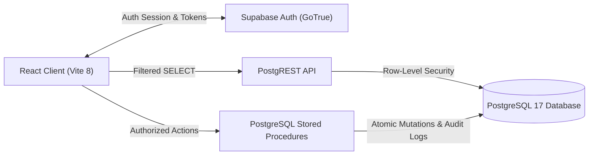
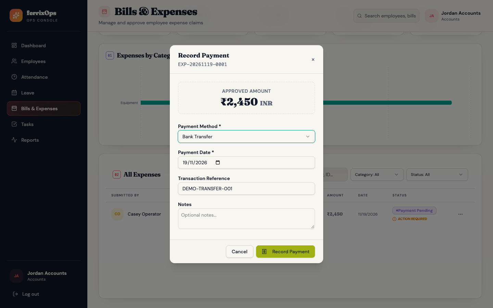

<div align="center">

# FerrixOps

### Manufacturing Operations and Workforce Management Platform


</div>

**FerrixOps** is an internal manufacturing operations and workforce management platform designed for industrial teams of 30–50 personnel. Built with React 19, Tailwind CSS 4, and Supabase on PostgreSQL 17, it unifies employee directory administration, server-timestamped attendance, leave tracking, multi-tier expense approvals, and kanban task management into a single authenticated application. All access boundaries, workflow status transitions, and audit trails are enforced at the database layer through Row-Level Security (RLS) and atomic PostgreSQL stored procedures. Local benchmark evaluations demonstrate a 65.8% p95 latency reduction on mixed expense read workloads via scalar subquery InitPlan optimizations.

[Engineering walkthrough](docs/WALKTHROUGH.md) · [Local setup guide](docs/LOCAL_SETUP.md) · [Benchmark report](docs/ferrixOps_API_BENCHMARK_RESULTS.md) · [Benchmark evidence](benchmarks/evidence/2026-11-04-policy-initplan/)

---

## Table of contents

- [Features](#features)
- [Architecture and authorization](#architecture-and-authorization)
- [Expense approval workflow](#expense-approval-workflow)
- [Prerequisites](#prerequisites)
- [Installation](#installation)
- [Usage](#usage)
- [Configuration](#configuration)
- [Project structure](#project-structure)
- [Testing](#testing)
- [Deployment](#deployment)
- [Performance benchmark](#performance-benchmark)
- [Roadmap](#roadmap)
- [Contributing](#contributing)
- [License](#license)
- [Acknowledgments](#acknowledgments)

---

## Features

- **Role-based operational workspaces**: Tailored portals and navigation menus for **Owner**, **Accounts**, and **Employee** roles, isolated via client route guards and enforced through PostgreSQL Row-Level Security (RLS).
- **Multi-tier expense approvals**: Structured lifecycle spanning employee draft submission, line-item verification by Accounts, executive Owner sign-off, and external bank disbursement recording.
- **Attendance and leave lifecycle**: Server-timestamped clock-in/out records, manager-reviewed punch corrections, and integrated leave requests with calendar validation.
- **Atomic task management**: Kanban board with drag-and-drop sequencing, strict state transitions serialized via PostgreSQL row locks (`SELECT ... FOR UPDATE`), and atomic audit logging.
- **Optimized read performance**: PostgREST scalar subquery InitPlan optimizations eliminating per-row function evaluation for a 65.8% p95 read latency reduction across 10,000 synthetic records.
- **Protected document storage**: Private Supabase Storage bucket for receipt attachments with time-limited signed URL generation and server-side MIME verification.

---

## Architecture and authorization

FerrixOps decouples frontend presentation from backend security. The React user interface guides users through next actions, but all authorization boundaries, row visibility rules, and workflow state transitions are verified independently in PostgreSQL.



### Role-based access control (RBAC)

| Role         | Scope & Permissions                                                           | Permitted Actions                                                                               |
| :----------- | :---------------------------------------------------------------------------- | :---------------------------------------------------------------------------------------------- |
| **Owner**    | Complete organizational and financial visibility across all records           | Account provisioning, leave & attendance approvals, final expense sign-off, task delegation     |
| **Accounts** | Financial review, expense auditing, and read-only directory/attendance access | Review submitted expenses, record external bank disbursements, inspect workforce records        |
| **Employee** | Self-service operations restricted to personal records and assignments        | Clock in/out, submit leave requests, file draft/submitted expense claims, update assigned tasks |

Direct client table mutations are revoked for core business workflows. State transitions occur through transactional stored procedures (`SECURITY DEFINER` with explicit search paths) that validate caller identity, current record state, and audit log generation in a single database transaction.

---

## Expense approval workflow

Expenses move through a deterministic state machine before external reimbursement is recorded:

1. **Employee submission**: The employee creates a draft claim, uploads receipts to the private storage bucket, and submits. `submit_expense` locks the draft row, verifies ownership, and transitions it to `SUBMITTED`.
2. **Accounts review**: Accounts inspects line items under **Needs My Action**. Approving via `review_expense_accounts` advances the claim to `PENDING_OWNER_APPROVAL`. Accounts may also reject or return with remarks for revision.
3. **Owner sign-off**: The Owner evaluates the claim and executes `review_expense_owner`, moving it to `PAYMENT_PENDING`.
4. **Payment recording**: Accounts records the disbursement with an external payment reference (e.g., bank transfer code). `record_payment` locks the approved record, inserts into `expense_payments`, flags the status as `PAID`, and logs the audit event atomically.



_Detailed step-by-step reproduction instructions are available in the [Engineering walkthrough](docs/WALKTHROUGH.md)._

---

## Prerequisites

- **Node.js**: `v22.12.0` or later (tested on Node 22 LTS)
- **npm**: `v10.0.0` or later
- **Docker Desktop**: Required to run the local Supabase container stack (PostgreSQL 17, PostgREST, GoTrue Auth, Storage, and Inbucket)
- **Python 3**: `3.10+` (optional; only needed for the standalone task database regression runner)
- **PostgreSQL Client Binaries**: `initdb`, `pg_ctl`, and `psql` with `pgcrypto` (optional; only required for `npm run test:db`)

---

## Installation

```bash
# 1. Clone the repository
git clone https://github.com/TheVishKay/Ferrix-Ops.git
cd Ferrix-Ops

# 2. Install dependencies with pinned lockfile
npm ci

# 3. Start the local Supabase development environment
npx supabase start

# 4. Create the local environment file
cp .env.example .env
```

After starting Supabase, retrieve your local API URL and publishable anonymous key from the CLI output (or by running `npx supabase status`), and populate `.env`:

```env
VITE_SUPABASE_URL=http://127.0.0.1:54321
VITE_SUPABASE_PUBLISHABLE_KEY=your-local-anon-key
```

Start the local development server:

```bash
npm run dev
```

The application will be accessible at `http://localhost:5173`.

---

## Usage

### Seed synthetic demo accounts

To exercise the multi-role approval workflow locally:

1. Navigate to the local Supabase Studio URL (`http://127.0.0.1:54323`).
2. Under **Authentication → Users**, create three confirmed users:
   - `owner@ferrixops.example`
   - `accounts@ferrixops.example`
   - `employee@ferrixops.example`
3. Execute the role-assignment and employee profile script provided in the [Local setup guide](docs/LOCAL_SETUP.md#seed-a-synthetic-expense-demo) within the Studio **SQL Editor**.
4. Log into the web application as `employee@ferrixops.example` to file a claim, `accounts@ferrixops.example` to review, and `owner@ferrixops.example` to grant final authorization.

---

## Configuration

The application requires two frontend environment variables defined in `.env`:

| Name                            | Description                               | Default                  | Required |
| :------------------------------ | :---------------------------------------- | :----------------------- | :------- |
| `VITE_SUPABASE_URL`             | Base URL of the Supabase API gateway      | `http://127.0.0.1:54321` | Yes      |
| `VITE_SUPABASE_PUBLISHABLE_KEY` | Client-side anonymous/publishable API key | None                     | Yes      |

> [!IMPORTANT]
> Never expose administrative credentials such as `SUPABASE_SERVICE_ROLE_KEY` in `VITE_*` variables or client bundles. Service-role privileges bypass RLS and are strictly confined to backend Edge Functions.

---

## Project structure

```text
.
├── benchmarks/         # Automated load testing harness, query plans & statistical evidence
├── docs/               # Technical walkthroughs, architecture notes, and benchmark reports
│   ├── case-study/     # Interactive case study static report and styles
│   ├── images/         # UI workflow captures and visual assets
│   ├── LOCAL_SETUP.md  # Detailed local stack setup, user seeding & demo instructions
│   └── WALKTHROUGH.md  # 5-minute deep-dive on expense and task RPC state machines
├── public/             # Static public web assets
├── scripts/            # Standalone Python PostgreSQL concurrency and isolation runners
├── src/
│   ├── components/     # Reusable UI primitives, forms, dialogs, and layout containers
│   ├── contexts/       # React contexts for authentication session management
│   ├── hooks/          # Custom hooks for viewport, debounce, and state binding
│   ├── lib/            # Utilities and Supabase client configuration
│   ├── pages/          # Top-level view routes (Attendance, Expenses, Tasks, etc.)
│   └── services/       # Client service wrappers for Supabase RPCs and table queries
├── supabase/
│   ├── functions/      # Deno-based Supabase Edge Functions (admin provisioning)
│   └── migrations/     # Version-controlled PostgreSQL schemas, RLS, and RPC definitions
└── tests/              # Subsystem unit tests and database integration fixtures
```

---

## Testing

```bash
# Run ESLint across all JavaScript/JSX source files
npm run lint

# Format codebase using Prettier
npm run format

# Validate production bundle build
npm run build

# Run unit tests for the benchmark harness utilities
npm run bench:unit

# Run the task database regression suite (requires Python 3 & local postgresql)
npm run test:db

# Run the quick smoke test for the expense API benchmark
npm run bench:smoke

# Execute the full paired benchmark suite across 10,000 synthetic records
npm run bench:full
```

### Continuous integration (CI)

GitHub Actions runs automated checks on every pull request and push to `main` via [.github/workflows/ci.yml](.github/workflows/ci.yml):

- **frontend job**: Sets up Node.js 22, installs dependencies via `npm ci`, runs benchmark unit checks (`npm run bench:unit`), executes ESLint (`npm run lint`), and verifies production compilation (`npm run build`).
- **task-database job**: Boots an Ubuntu runner with PostgreSQL and `pgcrypto` to execute `scripts/test_task_database.py`, testing role authorization, row locking, and transactional rollback on audit failures.

---

## Deployment

### Production build

```bash
npm run build
```

To inspect route chunks, lazy-loaded dependencies, and bundle weight:

```bash
npm run build -- --manifest
# Output manifest generated at dist/.vite/manifest.json
```

### Hosting target recommendations

- **Frontend SPA**: Deploy `dist/` to any static hosting provider (e.g., Vercel, Netlify, Cloudflare Pages). Configure a single rewrite rule redirecting all non-file requests to `/index.html`.
- **Database & Auth**: Target a hosted Supabase project using `npx supabase db push` to apply migrations in order.
- **Edge Functions**: Deploy administrative functions (`create-employee`, `update-employee-status`) via `npx supabase functions deploy` with server-side secrets.
- **Storage**: Verify that the `expense-documents` bucket is set to private and that download URLs are generated exclusively through signed endpoints.
- **Production deployment verification**: GitHub records a verified Vercel production deployment (deployment `7785423810`, commit `91ed3b9`).

---

## Performance benchmark

Investigation of read latency under concurrent access revealed that standard RLS policies evaluated `get_my_role()` repeatedly for every scanned candidate row. By wrapping the role-helper call in a scalar subquery `(SELECT (get_my_role()))`, PostgreSQL evaluates the role once per statement using an `InitPlan`.

```sql
-- Migration 20261104000001_optimize_expense_read_policies.sql
DROP POLICY IF EXISTS "expenses_select_owner" ON public.expenses;
CREATE POLICY "expenses_select_owner"
  ON public.expenses FOR SELECT
  USING ((SELECT (get_my_role())) = 'OWNER');
```

- **Experimental setup**: 5 paired runs alternating baseline and candidate configurations in an isolated local Supabase stack; 10,000 synthetic expenses, 50 employees, 20 virtual clients, 260,351 measured requests.
- **Result**: Median p95 read latency dropped from **104.89 ms to 35.90 ms** (**65.78% reduction**) with zero response errors.
- **Detailed report**: Complete methodology, query class distributions, and deep-page trade-offs are documented in [docs/ferrixOps_API_BENCHMARK_RESULTS.md](docs/ferrixOps_API_BENCHMARK_RESULTS.md).

---

## Roadmap

Tracked in [docs/ferrixOps_RESUME_ROADMAP.md](docs/ferrixOps_RESUME_ROADMAP.md) and architectural specs:

- [ ] **Automated payroll processing**: Attendance-linked gross wages and statutory deduction calculations (detailed in [PAYROLL_MODULE_SPECIFICATION.md](PAYROLL_MODULE_SPECIFICATION.md)).
- [ ] **Document lifecycle management**: Automated scheduled workers to prune orphaned receipt uploads from canceled or draft expense records.
- [ ] **Attendance exception handling**: Support for multi-day missing check-in regularization with supervisor approvals.
- [ ] **Export pipelines**: Formatted CSV and PDF export generation for fiscal expense audits and attendance timesheets.
- [ ] **Optimistic task concurrency**: Enhanced conflict handling and status reconciliations for high-concurrency kanban reordering.

---

## Contributing

1. Fork the repository and create your feature branch:
   ```bash
   git checkout -b feat/your-feature-name
   ```
2. Adhere to [Conventional Commits](https://www.conventionalcommits.org/) for commit messages (`feat:`, `fix:`, `perf:`, `test:`, `docs:`, `chore:`).
3. Ensure code formatting and linting pass:
   ```bash
   npm run format
   npm run lint
   ```
4. Verify that existing benchmark and database tests pass:
   ```bash
   npm run bench:unit
   ```
5. Submit a pull request against `main` describing the changes and testing evidence.

---

## License

This project is licensed under the terms of the [MIT License](LICENSE).

---

## Acknowledgments

- [Supabase](https://supabase.com/) for PostgreSQL database infrastructure, GoTrue Auth, and Storage.
- [Radix UI](https://www.radix-ui.com/) and [Tailwind CSS](https://tailwindcss.com/) for UI primitives and responsive styling.
- [Lucide Icons](https://lucide.dev/) for dashboard and navigation iconography.
- [Recharts](https://recharts.org/) for operational metrics and analytics charts.
- [@hello-pangea/dnd](https://github.com/hello-pangea/dnd) for accessible drag-and-drop kanban task sequencing.
