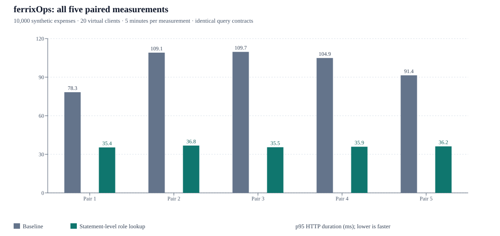
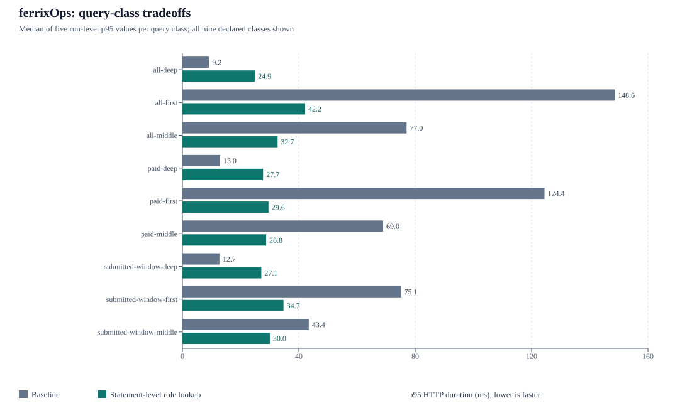

# ferrixOps expense API benchmark 

**Measured outcome:** statement-level role-helper evaluation reduced the median run-level p95 of the declared mixed expense-read workload from **104.89 ms to 35.90 ms (65.78%)**. The five-pair local test used **10,000 synthetic expenses, 50 synthetic employee records and 20 virtual clients**, with **260,351 measured requests and zero HTTP or response-correctness failures**.

This is a local synthetic HTTP benchmark, not factory deployment, real-user adoption, page-load performance, write throughput or a latency guarantee for production. Deep-page query classes regressed; the result supports a **mixed-workload** claim, not “every expense query became faster.”

## Problem, investigation and actual change

Expense policies called `public.get_my_role()` directly in their OWNER/ACCOUNTS read predicates. The helper is STABLE, takes no row arguments and looks up the current authenticated user's profile role. Representative authenticated plans showed a full expense scan with role-helper expressions in its row filter.

An initial index-only diagnostic at commit `b834566` added two composite indexes. One completed pair returned p95 values of 77.25 ms before and 84.00 ms after; the representative plans still used sequential scans. This did not establish an indexing benefit. The exploratory run was intentionally stopped, its artifacts retained, and its numbers excluded from the final policy experiment. A single diagnostic pair is not proof that indexes can never help this workload.

The final change, committed and frozen as [`a31ea38`](https://github.com/TheVishKay/Alum_Factory_EMS/commit/a31ea38), is [an additive migration](../supabase/migrations/20261104000001_optimize_expense_read_policies.sql) that wraps the row-independent role helper in scalar SELECT subqueries in two existing SELECT policies. Candidate plans contain the expected InitPlans. This follows [Supabase's RLS performance guidance](https://supabase.com/docs/guides/database/postgres/row-level-security-performance).

Policy roles, commands, grants, ownership access and the ACCOUNTS status restriction remain unchanged. No new indexes were shipped. The EMPLOYEE policy was not rewritten, RLS stayed enabled, and measured requests used real Auth tokens rather than service-role credentials. This migration has **not** been applied to hosted Supabase by this work.

## Method and environment

| Setting            | Value                                                                                                                                                                |
| ------------------ | -------------------------------------------------------------------------------------------------------------------------------------------------------------------- |
| Benchmark source   | `a31ea3881b445474e611438620388fb715d2d044`, clean working tree at start                                                                                              |
| Environment        | Local Mac, Node 26.5.0, PostgreSQL 17.11, Supabase CLI 2.122.0                                                                                                       |
| Backend            | Isolated Docker stack: Auth, PostgREST, PostgreSQL, Kong and Storage; Docker VM reported 10 CPUs and 8,319,504,384 bytes memory                                      |
| Data               | 10,000 deterministic synthetic expense rows; 50 employee records; five categories; seed 20261025; deliberately tied timestamps and skewed ownership                  |
| Timed identity     | One synthetic OWNER account shared by 20 virtual-client loops; these are not 20 real users or necessarily 20 simultaneous in-flight requests                         |
| Query contract     | Same explicit projection/employee join, 50-row page, `created_at DESC, id DESC`, keyset cursor and filters in both variants                                          |
| Mix                | Nine declared query classes: unfiltered, paid and submitted/date-window, each at first/middle/deep pages                                                             |
| Duration           | Five minutes measured plus 30 seconds separate warmup per variant; five pairs, alternating baseline/candidate order                                                  |
| Think time         | 200 ms outside the measured operation                                                                                                                                |
| Response timing    | Monotonic Node clock from fetch start through full body consumption; includes connection establishment when needed; excludes JSON parsing and correctness comparison |
| Encoding           | Identity requested; body-byte counts, not total TLS/header/wire bytes                                                                                                |
| Comparison         | Median of the five run-level mixed-workload p95 values for each variant; all-attempt latencies retained                                                              |
| Baseline isolation | New temporary stack; selected optimization migration withheld at startup; original policy expressions restored for every baseline phase                              |

The normalized paginated contract belongs to the benchmark harness. This is not a measurement of the original unpaginated browser screen, and the UI has not been switched to this page contract. The production policy migration applies to expense reads generally, but performance outside the tested contract has not been established.

## All five paired results

| Pair                       | Execution order      | Baseline requests | Baseline p95 ms | Optimized requests | Optimized p95 ms | Failures |
| -------------------------- | -------------------- | ----------------- | --------------- | ------------------ | ---------------- | -------- |
| 1                          | Baseline → optimized | 25,663            | 78.30           | 27,200             | 35.36            | 0        |
| 2                          | Optimized → baseline | 24,580            | 109.06          | 27,121             | 36.80            | 0        |
| 3                          | Baseline → optimized | 24,413            | 109.66          | 27,201             | 35.50            | 0        |
| 4                          | Optimized → baseline | 24,934            | 104.89          | 27,083             | 35.90            | 0        |
| 5                          | Baseline → optimized | 25,036            | 91.42           | 27,120             | 36.19            | 0        |
| **Total / median run p95** |                      | **124,626**       | **104.89**      | **135,725**        | **35.90**        | **0**    |



The reduction is `(104.89186644996516 - 35.89669999964535) / 104.89186644996516 × 100 = 65.7774%`. These are medians of repeated run-level p95 values, not a pooled percentile or the fastest run. Baseline variation is visible in the table; five repetitions do not establish statistical significance or eliminate same-machine confounding.

Each optimized run's aggregate p95 was lower than its paired baseline. Successful operation rates were approximately 81.3–85.5/s before and 90.2–90.6/s after. This was a closed-loop workload with fixed think time, so those rates are not server-capacity limits and are not results at an equal offered arrival rate.

## Query-class tradeoff — retained, not hidden

Median of the five per-run p95 values for each class:

| Query class                    | Baseline ms | Optimized ms | Direction  |
| ------------------------------ | ----------- | ------------ | ---------- |
| Unfiltered — first             | 148.56      | 42.16        | Faster     |
| Unfiltered — middle            | 77.04       | 32.71        | Faster     |
| Unfiltered — deep              | 9.16        | 24.91        | **Slower** |
| Paid — first                   | 124.44      | 29.58        | Faster     |
| Paid — middle                  | 68.98       | 28.78        | Faster     |
| Paid — deep                    | 12.95       | 27.72        | **Slower** |
| Submitted/date-window — first  | 75.15       | 34.73        | Faster     |
| Submitted/date-window — middle | 43.42       | 30.04        | Faster     |
| Submitted/date-window — deep   | 12.73       | 27.12        | **Slower** |



The mixed-workload tail improved, but deep-page p95 increased by roughly 14–16 ms. The benchmark does not establish why those class-level plans/timings regressed; targeted Data API plan profiling and a follow-up pagination/index experiment are appropriate next work. A deep-page-heavy workload may reach a different conclusion. Do not describe this migration as a uniform speedup or deploy it on the strength of the aggregate alone.

## Correctness and independent verification

- **49 logical correctness scenarios per variant**, executed before each of ten measurements: expected ordered data, complete cursor traversal without gaps/duplicates, empty filters, OWNER/ACCOUNTS/EMPLOYEE visibility, own-draft semantics, peer isolation, missing profile, anonymous access and invalid tokens. That is 490 scenario executions, not 490 distinct test cases.
- Every measured response was checked against a deterministic golden digest. No HTTP, timeout or semantic failures were observed in the 260,351 measured attempts.
- Catalog guards verified unchanged policy counts, policy roles/commands, unrelated predicates, table grants and RLS enablement. Recorded index definitions/sizes were identical across matched variants.
- Independent Python standard-library verification recomputed the p50/p95 values, throughput and per-query percentiles from every compressed raw-sample file, and verified source/migration hashes against the recorded Git revision. It also checked matching per-query body sizes, policy metadata and candidate InitPlans.
- The load generator used about 11.2–12.9% of one CPU core; its event-loop p95 was about 11.1–11.3 ms. No configured generator-saturation warning fired. Server/host resource contention is not ruled out by those generator-only checks.
- [GitHub CI](https://github.com/TheVishKay/Alum_Factory_EMS/actions/runs/41784053183) and the [clean Linux smoke workflow](https://github.com/TheVishKay/Alum_Factory_EMS/actions/runs/41784082648) passed for the measured revision. Linux smoke timings are not combined with the local full benchmark.
- The temporary benchmark containers were removed on completion. Normal local and hosted Supabase data was not seeded or reset.

## Evidence and reproduction

The [retained evidence](../benchmarks/evidence/2026-11-04-policy-initplan/) contains the complete confirmatory samples/summaries, source and migration manifests, charts and independent verification output, plus the earlier index-only diagnostic and its intentional-abort record. Only synthetic/scrubbed artifacts are included; passwords, API keys and Auth tokens are not retained.

Verify the retained result without starting Docker:

```bash
python3 benchmarks/verify_results.py benchmarks/evidence/2026-11-04-policy-initplan/confirmatory
node benchmarks/plot-results.mjs benchmarks/evidence/2026-11-04-policy-initplan/confirmatory
```

Re-run the measured implementation from a separate checkout of `a31ea38`, install its lockfile, start Docker, and run `npm run bench:unit` followed by `npm run bench:full`. The [manifest](../benchmarks/evidence/2026-11-04-policy-initplan/confirmatory/manifest.json) records the actual runtime, image identifiers, hardware, hashes and settings. Different hardware, runtime versions, container images or background load need not reproduce the same millisecond values. Preserve unsuccessful and unfavorable results instead of selecting a faster run.

## Resume wording supported by this experiment

> Optimized PostgreSQL RLS evaluation, reducing mixed-workload expense API p95 latency by **66% (104.9 → 35.9 ms)** across **10,000 synthetic records and 20 virtual clients**, validated over five paired benchmark runs.

Keep “mixed-workload” and “synthetic” in the wording or immediately accessible methodology. This result supports a reproducible engineering-performance claim; it does not support “used by 50 factory employees,” real processing-time savings, production uptime or a blanket claim that every expense query improved.
